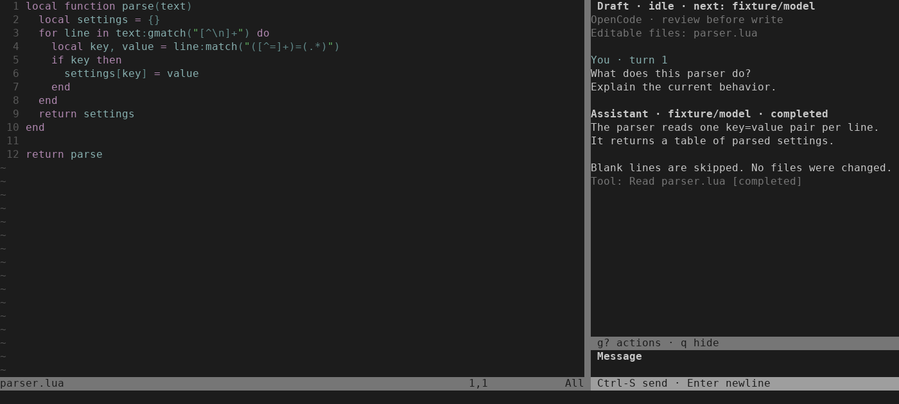

# Draft.nvim

Codex or OpenCode beside your code, with approval before project writes.

Discuss selected files, request an edit, then inspect its frozen diff. In managed
chat, the agent edits isolated copies. Your project changes when you approve.



*Development UI with a deterministic test provider. The published beta has the
earlier presentation.*

## Requirements

- Linux with working Bubblewrap (`bwrap`) and user/PID namespaces.
- Neovim **0.12+** with LuaJIT. Neovim 0.11 is unsupported.
- Python 3, Git and a POSIX shell; `rg` for the staged file picker.
- Your chosen CLI, installed and authenticated separately:

| Backend | Required version | Plugin version |
| --- | --- | --- |
| OpenCode | **1.18.34 / ACP 1** | Published beta or development checkout |
| Codex | **0.163.0**, including its matching code-mode host | Development checkout |

Other OpenCode versions are refused. Codex also needs a host that supports its
nested sandbox; Draft checks this before sending a prompt.

Tmux is optional. macOS and Windows are unsupported.

## Install

For the published OpenCode beta, pin the release with lazy.nvim:

```lua
{
  "ruohao1/draft.nvim",
  tag = "v0.1.0-beta.1",
  config = function()
    require("draft").setup()
  end,
}
```

Restart Neovim, then run:

```vim
:checkhealth draft
```

For **Codex or the updated UI**, use a
[development checkout](docs/releases/install-upgrade-rollback.md#choose-an-available-version).
Follow the [Codex configuration guide](docs/usage.md#codex) before opening chat.
Use a dedicated ChatGPT login with `chat.auth_store`, or an API-key file with
`chat.auth_file`. Close keeps the dedicated login for the next conversation.
The beta tag does not include managed Codex.

Configure Draft on the first `setup()` call. Restart after changing setup options
or the plugin version. Keep one installation per Neovim process.

See [release notes](docs/releases/v0.1.0-beta.1.md) and the
[install, upgrade and rollback guide](docs/releases/install-upgrade-rollback.md)
for existing installations or migration from an embedded `lua/ai` copy.

## Start with OpenCode chat

1. Open and save an existing text file in your project. Supported file permissions
   are `0644` and `0755`; Draft does not change them for you.
2. Run `:NvimAIStageSetup`. Choose an available `provider/model`, set an existing
   auth-file path if needed, then choose **Save and enable**.
3. Run `:NvimAIChat`. The current file is selected. Opening chat sends nothing.
4. Press `i`, type a question, then press **Ctrl-S** to send. Enter adds a newline.
5. Ask for a small edit. Its frozen diff opens when generation finishes. If you
   are typing, press Escape to show it. Your project file is still unchanged.
6. Press **a** to accept this file or **r** to reject it. Press **f** to return to
   chat and continue the conversation.
7. Run `:NvimAIChatClose` when finished. Confirm discarding pending proposals if
   asked. Previously accepted files stay saved.

[View the frozen-review UI](docs/images/presentation-review-wide.png)
(development checkout, synthetic proposal).

To select several files, start with `:NvimAIChat src/one.lua src/two.lua`.
The editable selection stays fixed until close. Read-only context can be attached
later; see [context and corrections](docs/usage.md#context-and-corrections).

Press Escape then `q` to hide chat. `:NvimAIChat` restores the transcript and
unsent draft. Sending while review is pending discusses or revises the proposal;
it does not accept it.

If Ctrl-S freezes terminal output, press Ctrl-Q. You can also send with
`:NvimAIChatSend`. If a native companion is open, close it with `:NvimAIClose`
and resolve its review before starting managed chat.

## Essential keys

Except Ctrl-S and Enter in the composer, use these keys in Normal mode.
`g?` lists the actions available in the current state.

| Where | Key | Action |
| --- | --- | --- |
| Composer | Ctrl-S / Enter | Send / add a newline |
| Chat | `gi` / `q` | Focus composer / hide chat |
| Chat | `gd` | Open frozen review |
| Chat | `gm` | Choose the next-turn model while idle |
| Chat | `gc` | Cancel work or confirm discarding pending review |
| Review | `a` / `r` | Accept / reject the current file |
| Review | `]f` / `[f` | Next / previous file |
| Review | `f` | Return to chat |
| Chat or review | `g?` | Show available actions |

In chat, `gr` retries only when safe and `gx` closes the conversation.
Global leader mappings are off by default; enable them with `keymaps = true`.
See `:help draft-mappings` for the complete list.

## Further help

- [Usage guide](docs/usage.md): Codex setup, context, corrections and other workflows.
- [Complete reference](doc/draft.txt), also available with `:help draft`.
- [Safety and recovery](docs/usage.md#safety-and-recovery): failures, retained data and cleanup.
- [Changelog](CHANGELOG.md) and [testing and validation](tests/README.md).

Draft is early Linux software. Crash recovery and retention management are
incomplete, and approval across several files is not atomic. The optional native
CLI companion uses **after-write review**; managed chat uses **review before write**.

Licensed under [MIT](LICENSE).
