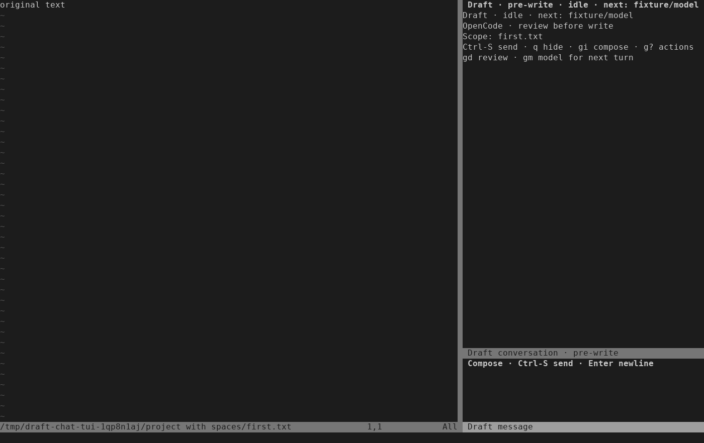
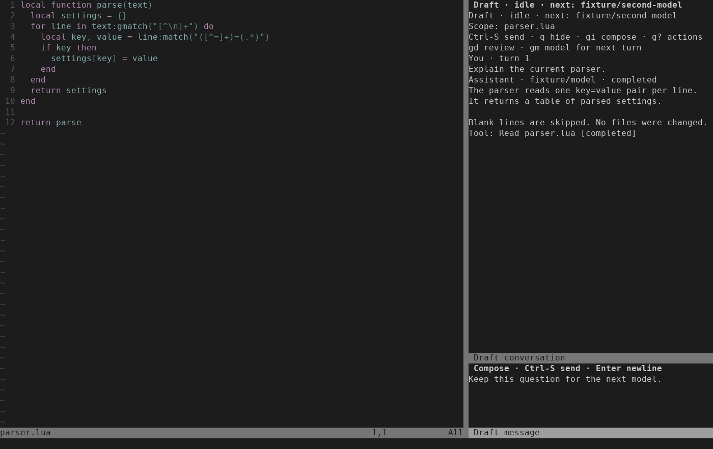
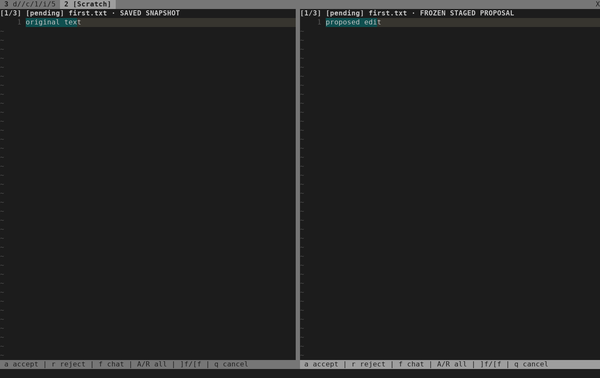
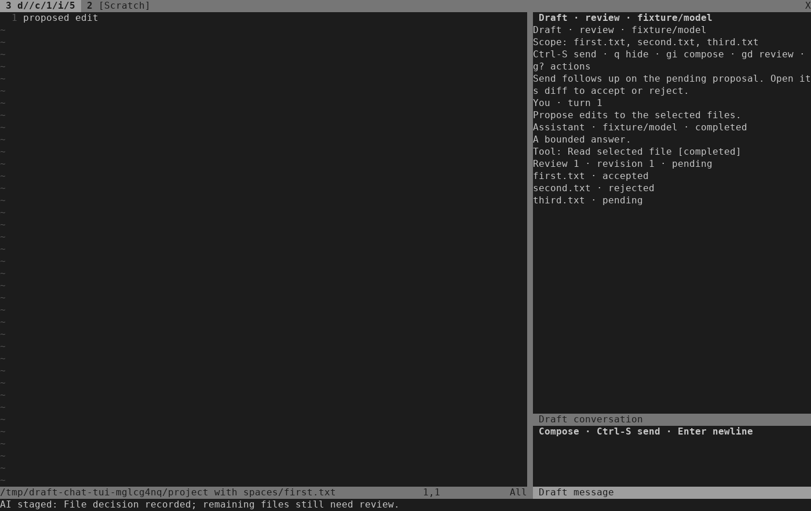
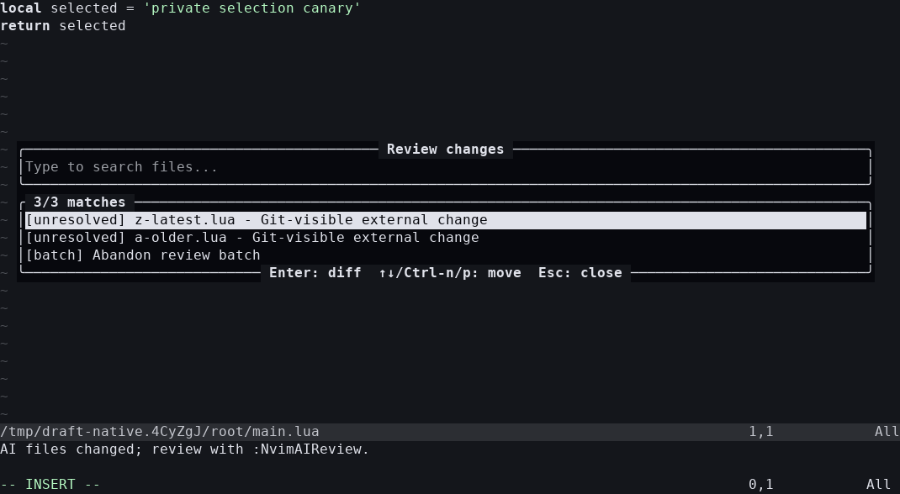

# Draft.nvim

Codex or OpenCode beside your code, with approval before project writes.

Start with [OpenCode chat](#start-with-opencode-chat) or [managed Codex](#managed-codex-chat): discuss selected saved
files, request an edit, inspect its frozen diff, then approve or reject it.
`:NvimAIChat` keeps the conversation and review inside Neovim. Tmux is optional.

Draft is an early Linux plugin. In managed chat, the agent edits isolated copies; project
files change only when you approve a frozen proposal. Review happens after
generation finishes, before project writes.

For a single instruction without chat, use [standalone staging](#standalone-staged-edits).
The optional [native CLI companion](#native-companions-and-after-write-review)
has **after-write review**: the agent writes first, then you inspect its changes.

## Requirements

- Linux with working Bubblewrap (`bwrap`) and user/PID namespaces.
- Neovim **0.12+** with LuaJIT; tested with **0.12.4**. Neovim 0.11 is unsupported.
- Python 3 (standard library only), Git, and a POSIX shell. Tested with Python
  **3.14.4**, Git **2.53.0**, and Bubblewrap **0.11.1**.
- The CLI for your chosen backend, installed and authenticated separately.
  Managed OpenCode and staging require exactly **OpenCode 1.18.34 / ACP 1**;
  other OpenCode versions are refused. Managed Codex requires exactly **Codex
  0.163.0** and a Linux host that supports its nested sandbox; readiness is
  checked before sending a prompt.
- `rg` (ripgrep) for the staged file picker.
- Optional tmux. Health recommends **3.7+** for the full tmux integration;
  the beta release is tested with **3.7c**. Without tmux, the native
  companion uses a Neovim terminal split.

macOS and Windows launches are not supported. Linux fixture results do not
establish live-provider acceptance across all three backends.

When upgrading from OpenCode 1.18.30 or 1.18.28, restart Neovim with the updated
plugin. If an old companion remains, run `:NvimAIClose`, confirm its closure,
then `:NvimAIOpen`. Draft preserves saved session and review references while
creating a fresh profile for 1.18.34.

## Install

Install the published [v0.1.0-beta.1 Linux/OpenCode beta](https://github.com/ruohao1/draft.nvim/releases/tag/v0.1.0-beta.1).
Pin the release tag to use the tested version. See the
[release notes](docs/releases/v0.1.0-beta.1.md) and
[installation, upgrade and rollback guide](docs/releases/install-upgrade-rollback.md)
for the matching OpenCode version and how to change an existing installation.

With lazy.nvim:

```lua
{
  "ruohao1/draft.nvim",
  tag = "v0.1.0-beta.1",
  config = function()
    require("draft").setup()
  end,
}
```

Or add a checkout to your runtime path from your Neovim configuration:

```lua
vim.opt.runtimepath:prepend(vim.fn.expand("~/src/draft.nvim"))
require("draft").setup()
```

Then run `:checkhealth draft`. Loading and setup register commands without
installing a CLI, launching a companion, reading credentials, or sending a
prompt. Helpers load from the plugin's own `scripts/` directory; do not copy
them into your Neovim config directory.

Configure options on the first setup call; repeated setup calls return the
existing runtime. Restart Neovim after changing the plugin version or setup
options. The internal `ai` module names and `NvimAI*` commands are retained;
use one installation per Neovim process.

If migrating from an embedded `lua/ai` copy, move that copy out of your
Neovim configuration before loading Draft so its internal modules resolve from
the plugin.

## Start with OpenCode chat

After installation and `:checkhealth draft`:

1. Open and save one existing text file with permissions `0644` or `0755` in your
   project. If a native companion is open, close it with `:NvimAIClose` and resolve
   any pending native review.
2. Run `:NvimAIStageSetup`. Choose an explicit `provider/model` available to your
   OpenCode account and an existing auth-file path if needed. Choose **Save and
   enable**. This setup is shared by chat and standalone staging; it sends no prompt.
3. Run `:NvimAIChat`. The composer opens with the current file selected. Opening
   does not launch a provider, discover models or send work.
4. Press `i`, type a question about the file, and press **Ctrl-S** to send.
   Enter adds a newline. Read the reply, then ask for a small edit and send again.
5. The first pending frozen diff opens automatically when the proposal is ready.
   If you are still typing, press Escape to show it. Your project file is still unchanged.
6. Inspect the diff. Press `a` to approve this file or `r` to reject it.
   Only approval writes the proposed contents to your project.
7. Run `:NvimAIChat` to return to the composer, or press `f` while a diff is open.
   Continue the conversation with `i` and Ctrl-S. With review pending, Send
   discusses or revises the proposal; it does not approve it.
8. Run `:NvimAIChatClose` when finished. Confirm discarding pending proposals if
   asked. Earlier accepted files stay saved. Use `:NvimAIChatNew` for a new conversation.

Press Escape then `q` in chat to hide it. `:NvimAIChat` reopens the transcript and
unsent draft. For several files, start with `:NvimAIChat src/one.lua src/two.lua`;
the selection stays fixed until close.

Chat checks file permissions when opening and before each Send. An unsupported
mode, such as `0600`, identifies the file and the supported modes before
submission. A refused Send keeps your unsent draft. Choose a supported
file; Draft does not change file permissions for you.

After Send, chat shows its current startup step: checking credentials, starting
the selected backend, checking compatibility, opening or resuming the session, and confirming
the model. Use `gc` or `:NvimAIChatCancel` to stop waiting. Failures show a recovery
action; retry is offered only when the controller proves it safe.

`:NvimAIStatus` reports the active chat, including its startup step or failure
reason. `:checkhealth draft` shows the same chat state and defers native account
probes while managed chat is configured or open. Opening chat checks no account
access; readiness is checked on explicit Send. These diagnostics exclude credentials and conversation text.
See the [startup validation and measured timings](docs/validation/2026-10-03-chat-startup.md).

Chat always uses **review before write**, regardless of the saved
`:NvimAIPrompt` mode. `:NvimAIReviewMode` controls that prompt command's routing;
you do not need to change it to use chat. `:NvimAIChatReview` opens chat proposals;
`:NvimAIReview` is for changes already written by a native companion.

If Ctrl-S freezes terminal output, press Ctrl-Q to resume. To send without
Ctrl-S, press Escape and run `:NvimAIChatSend`.



## Managed Codex chat

The tagged beta above provides OpenCode chat. Managed Codex requires a checkout
containing this integration. Configure it on the first setup call:

```lua
require("draft").setup({
  chat = {
    backend = "codex",
    model = "openai/<advertised-codex-model>",
    auth_file = "/absolute/path/to/codex/auth.json",
    -- codex = "/absolute/path/to/codex",
  },
})
```

Use the same `:NvimAIChat`, Send, diff, Accept/Reject and Edit/Freeze workflow.
`chat` is a complete configuration: it does not inherit staged credentials,
provider options or saved preferences. Omit `chat` to keep the existing OpenCode
setup, or set `backend = "opencode"` with its own model/auth/provider options.
Both forms accept `root`, `python` and `bwrap`; only the chosen backend runtime is required.
The backend stays fixed until that conversation closes. Native companions and
standalone staging retain their existing behavior.

Install the native **Codex 0.163.0** CLI and its matching
`codex-code-mode-host` in the same directory. The complete `codex-package`
release archive contains both under `bin/`; point `chat.codex` at `bin/codex`.
The single-CLI archive is insufficient. Draft validates both executable files
and mounts them separately read-only. A missing or unsafe companion stops Send
before any prompt is submitted; the draft remains available. The companion
must be a regular executable, owned by you or root, with no symlink or group/world write access.

Codex requires an explicit `openai/model` from its advertised catalog. Send checks
CLI **0.163.0**, the model and nested command sandbox before submitting the turn.
The startup probe also checks that commands cannot read the private credential file.
Unsupported hosts fail before the prompt; there is no unconfined or native
fallback. Setup, opening/hiding chat, status and health do not import credentials
or start app-server. `:NvimAIChatModel` selects an advertised model for a later
explicit turn.

On first Send, Draft imports only the configured, owned, single-link **0600**
credential file: an OpenAI API key or saved ChatGPT login tokens. It creates a
private copy, leaves the original unchanged and retains private refresh writes
between stopped workers. Commands can read system tools and selected copies; the
private credential and conversation store are outside their readable filesystem. It does not copy global/project configuration, export
credentials or initiate login. Close removes safely owned private state; unsafe
state requires recovery. Installed-runtime checks use synthetic credentials and
a local provider. Live review/approval and actual token refresh remain separate
acceptance checks.

A start acknowledgement never opens a diff. Draft waits for matching terminal
completion, process exit and state/source validation. Cancel needs a matching
interrupted terminal event before continuation is eligible. Retry is explicit
and requires proven pre-submission cleanup; failed resume never starts a new
thread or replays the request automatically. See the [runtime evidence and host
limits](docs/validation/2026-10-20-managed-codex-runtime.md) and the
[code-mode companion validation](docs/validation/2026-10-27-codex-companion.md).

| Command | Purpose |
| --- | --- |
| `:NvimAIChat [files...]` | Open or focus the current conversation |
| `:NvimAIChatNew [files...]` | Start after confirmed close; confirm discarding an unsent draft |
| `:[range]NvimAIChatAttach` | Append a read-only buffer snapshot to the composer without sending |
| `:[range]NvimAIChatDiagnostics` | Append cached diagnostics to the composer without sending |
| `:NvimAIChatSend` | Submit the composer once, when the owner permits |
| `:NvimAIChatHide` | Hide without stopping or submitting |
| `:NvimAIChatCancel` | Cancel generation; confirm discarding a pending review |
| `:NvimAIChatRetry` | Retry only a failure proven safe to retry |
| `:NvimAIChatClose` | Close the owner; confirm discarding a pending review |
| `:NvimAIChatReview` | Choose another frozen proposal file or reopen its diff |
| `:NvimAIChatEditProposal` | Copy the visible pending proposal into an editable scratch buffer |
| `:NvimAIChatFreezeProposal` | Freeze the active correction as a new review revision |
| `:NvimAIChatDiscardCorrection` | Discard the correction; confirm when edited |
| `:NvimAIChatModel` | Choose an advertised model for the next turn while idle |
| `:NvimAIChatApprove` | Accept the visible pending file and advance after confirmation from the writer |
| `:NvimAIChatReject` | Reject the visible pending file, leaving it on screen |
| `:NvimAIChatApproveAll` | Confirm accepting all remaining files, after visiting every pending diff |
| `:NvimAIChatRejectAll` | Confirm rejecting all remaining pending files |

Inside either chat buffer, normal-mode `gi` focuses the composer, `gd` opens
review, `gm` chooses a model, `gc` cancels, `gr` retries, `gx` closes, and `g?` shows available actions.
Ctrl-S works in normal and insert modes; `q` hides only in normal mode.

After an explicitly sent turn negotiates model choices, press `gm` while idle
to choose from the latest advertised models for the configured provider. Before
that first negotiation, the picker explains that an explicit Send is required.
Selecting or cancelling never starts a worker, sends the draft or changes saved
settings. The `next:` label shows the selection; earlier replies keep their own
model labels. Generation, pending approval, failed sessions and closed history
refuse selection. Finish or explicitly discard pending review before switching.

The choice stays with this conversation, including hide/reopen, until changed.
An explicit New uses the saved default again. `:NvimAIStageSetup` separately
saves the default for future conversations. The next explicit Send resumes the
same session and revalidates the selected model before submitting. If options
change, authentication is missing, or model confirmation/resume fails, there is
no fallback model or replacement session. Follow the displayed recovery reason:
Retry is available only when proved safe; otherwise Close and explicitly start
a new conversation, which starts fresh context.

`gr` or `:NvimAIChatRetry` sends the current draft when it is nonempty; otherwise
it retries the failed prompt. It rechecks the selected files and never submits
automatically. A refused retry preserves the draft. Fix missing credentials at
the configured path before retrying; changing the configured path or model
requires Close and setup for a new conversation.

Use `gc` or `:NvimAIChatCancel` to stop work. Startup cancellation can require
Close because no completed cancellation was confirmed. Cancel and Close preserve
accepted files, unsaved source edits and the composer draft. A confirmed Close
ends the backend session; New starts fresh context and sends nothing by itself.
If the controller disconnects, Close cannot confirm cleanup. Preserve unsaved
source edits and your draft, inspect any uncertain writes, then restart Neovim.



The [model-selection validation record](docs/validation/2026-09-20-conversation-model.md)
covers synthetic providers and real editor keys.

The [Linux acceptance checklist](docs/validation/2026-09-20-conversation-linux.md)
combines model changes, per-file approval and failure recovery in a disposable
worktree-Neovim session, with exact expected file contents.

When a turn proposes edits, its first pending frozen diff opens automatically.
Typing keeps focus in the composer until you press Escape. A hidden chat or a
chat in another tab waits until you reopen it with `:NvimAIChat`. Each proposal
opens automatically once, so returning to chat does not bounce back to the diff.
Use `gd` or `:NvimAIChatReview` to choose another file or reopen a diff.

In the diff, `a` accepts the displayed file and advances to the next pending file;
`r` rejects it and stays on that file. Navigate with `]f`
and `[f`. `A` / `R` confirm accepting/rejecting all remaining files. Batch
approval requires visiting every pending diff in the current proposal revision.
The approval commands require visible frozen panels and do not open them for you.

Press `f` in a diff to return to the composer. **Send while review is pending is
a follow-up**: discuss the proposal or request a revision without accepting it.
A replacement automatically opens its first pending diff and requires fresh review;
previously accepted/rejected files remain confirmed context. Chat reports file
outcomes from the writer's receipts, including pending, accepted, rejected,
cancelled, blocked and uncertain states.

To correct a pending file yourself, run `:NvimAIChatEditProposal` from its visible
diff (or press `g?` there and choose **Edit proposal**).
Edit the separate scratch buffer normally, including undo/redo. Its label says
**not published**; the frozen panels stay read-only. Only one correction can be
active. `g?` opens the same actions menu in this buffer. Approval and follow-up
Send wait until you freeze or discard it.

Run `:NvimAIChatFreezeProposal` from that buffer to create a fresh frozen revision,
then review and accept it normally. Freeze sends no model prompt and saves no
project file. Earlier accepted/rejected files remain confirmed; every remaining
pending file needs a fresh visit before batch approval. Identical bytes keep the
original review; reverting to the saved baseline makes that file unchanged.
Changed manual revisions have a separate limit of 64 per conversation. At that
limit you can still freeze identical bytes, discard, approve or close.

The label distinguishes **0 bytes** from **final newline**. Deleting all visible
text with the newline flag on means one newline. For a zero-byte file use
`:setlocal noendofline`; use `:setlocal endofline` to restore the flag. Trailing
blank lines are preserved. Nonempty text must end in LF; UTF-8 text without BOM,
NUL or CR is required. Existing limits still apply: 20,000 newlines per file and
1 MiB combined proposal bytes. The 1 MiB encoded command limit includes JSON
escaping and metadata, so some otherwise valid large corrections are refused
without losing the draft.

`:NvimAIChatHide` retains the correction; Edit reopens it. Cancel, Close and
controller loss keep its text as a listed **Detached correction** buffer with
Freeze disabled; use `:ls` and `:buffer` to find it and copy text you need.
`:NvimAIChatDiscardCorrection` explicitly discards an active draft and resumes
the original eligible review. These buffers have no swap/undo persistence or
crash recovery: forced deletion or editor exit can lose unsaved text.


The [manual-correction validation record](docs/validation/2026-10-17-manual-corrections.md)
covers exact bytes, interruption and real editor keys.




The [automatic-review validation](docs/validation/2026-10-03-chat-auto-review.md)
covers focus, drafts and the keyboard journey in wide and narrow windows.

Return to chat with `f` or `:NvimAIChat`. In a diff, `q` confirms discarding pending
files. ChatCancel and ChatClose also confirm this; earlier accepted files stay
saved. Closing only the diff tab makes no decision. If sources or frozen panels
change, approval refuses. Close the conversation, inspect/save your changes, and
start a new one. An uncertain outcome requires inspecting disk before further work.

The selection stays fixed for the conversation: 1–16 saved existing files,
at most 1 MiB combined, with the same file requirements as staging. New without
paths reuses the closed conversation's selection. Save dirty selected buffers
before sending. A refused send preserves your draft. Native and standalone staged
work remain excluded even while chat is hidden or idle, until close is confirmed.

To include read-only context, return to a named file buffer inside the conversation's
project root. Run `:NvimAIChatAttach` for the whole buffer or
`:12,20NvimAIChatAttach` for whole lines. With `keymaps = true`, select text using
v, V or Ctrl-V and press `<leader>at` for the exact selection, including partial
lines or a rectangle. The Visual `:'<,'>NvimAIChatAttach` command uses whole lines.

The snapshot includes the relative path, range, capture time and modified state.
It uses current buffer text, including unsaved edits and new named files.
Line boundaries use LF; whole-buffer snapshots label the final-newline flag.
A CRLF file therefore appears as editor text, not a byte-for-byte disk copy.
The composer keeps your existing text. Edit, delete or undo the snapshot normally;
only Ctrl-S or `:NvimAIChatSend` submits it. Later source changes do not update
snapshots. Remove and reattach context to refresh it.

Capture requires a normal UTF-8 buffer with a canonical in-root path. Symlink
aliases, outside-root paths, binary text and unsupported controls are refused.
The source span is limited to 1 MiB, even for a small rectangle. Expanded visual
text must fit 32,768 bytes before extraction. The complete draft, including
metadata, fences and separators, must also fit 32,768 bytes; refusal leaves it intact.

The header lists **Editable files**. Context paths grant no additional file access
or editing authority. Attaching never saves a source, starts a provider or changes
the editable files. Save dirty editable files before Send. To change that set,
Close and start a New conversation.


Run `:NvimAIChatDiagnostics` in a named in-root buffer to append its cached
diagnostics from every namespace. Use `:12,20NvimAIChatDiagnostics` to include
records whose **starting line** is in that range. It does not request LSP/linter
updates or implicitly include source text. Each block says
**Cached diagnostics; freshness unverified**, with capture time and modified state.
It includes one-based line and byte column, severity, optional source/code, and
message. Nested producer data is omitted. Duplicates remain; stale positions
beyond the current buffer are kept without moving them to other lines.

A cache with more than 1,000 records is refused before retrieval. A smaller range
does not bypass this limit: reduce the cache or attach relevant text instead.
An eligible cache can contribute at most 100 matching records, subject to the
complete 32 KiB message limit. No matches leave the draft unchanged. Neither
overflow nor invalid data is truncated. The count API scans the cache; retrieval
copies nested producer data before Draft omits it. These limits do **not** impose
a hard total memory or latency bound.

The default right column becomes a bottom layout below 100 columns. Editors
smaller than 40 columns or 12 rows hide chat; resize and reopen explicitly.
The view keeps the newest 2 MiB / 20,000 lines and labels omitted earlier text.
The owner retains up to 64 turns / 32 MiB; composer submissions are limited to
32 KiB and oversized drafts are refused intact. Chat scratch buffers disable
swap files, persistent undo and modelines; no transcript archive is written.

## Standalone staged edits

Use `:NvimAIStage` for a single instruction without the chat composer. It shares
the model settings and review-before-write boundary described above.

1. Open and save a small text file in your project.
2. Run `:NvimAIStageSetup`. Choose an explicit `provider/model` and, if needed,
   the path to an existing OpenCode auth file. Choose **Save and enable**.
   This saves preferences, without submitting a request or reading credentials.
3. Run `:NvimAIStage` and enter an instruction. Or use
   `:NvimAIStage Replace the greeting in this file`.
4. Inspect the **SAVED SNAPSHOT / FROZEN STAGED PROPOSAL** diff. Your project
   file is still unchanged by Draft at this point.
5. Press `a` to approve the current file, `r` to reject it, or `q` to cancel
   pending proposals. Approval rechecks the saved source and loaded buffers.

`:NvimAIStageFiles` opens a searchable file picker. You can also pass explicit
paths: `:NvimAIStageFiles src/one.lua src/two.lua`. Staging supports 1–16 existing
files, with a 1 MiB aggregate limit for both originals and proposed contents.
Files must be owned regular files with one link, mode `0644` or `0755`, UTF-8,
Unix line endings, no BOM/NUL, and a final newline (or empty contents). Each
file is limited to 20,000 lines; ACL-bearing files are refused.

In the review tab:

| Key | Action |
| --- | --- |
| `a` | Approve this file and advance to the next pending diff |
| `r` | Reject this file |
| `A` / `R` | Confirm approval/rejection of remaining files |
| `]f` / `[f` | Next/previous selected file |
| `f` | Request a revision of pending proposals |
| `q` | Cancel remaining proposals |

Batch approval requires visiting the changed diffs. Closing the review tab also
cancels pending proposals. Earlier accepted files stay written after a rejection,
cancellation, or follow-up. `:NvimAIStageFollowup [instruction]` revises only
pending proposals; predecessor approval tokens are retired.

Use `:NvimAIStageStatus` to inspect the current phase and exact artifact path,
`:NvimAIStageReview` to reopen review, and `:NvimAIStageCancel` to cancel work.
`:NvimAIStageReset` confirms forgetting preferences and disabling staging.

To route the normal prompt command through staging, run
`:NvimAIReviewMode pre_write`. It is a separate explicit choice; resetting
staging does not silently switch prompting back to native writes. Invalid
settings or unsupported backends refuse the prompt without a native fallback.

## Native companions and after-write review

This is an optional terminal workflow. Use `:NvimAIChat` for the recommended
OpenCode conversation with approval before project writes.

`:NvimAIOpen` opens a read-only companion or focuses the existing one. Choose
an installed backend with `:NvimAIBackend [codex|claude|opencode]`.
OpenCode's first native use performs a local compatibility check; the picker
reports when validation is pending or unavailable.

`:NvimAINativePrompt` prepares explicit buffer/selection context and an
after-write review baseline, transfers the prompt into the native companion,
and focuses it **without submitting**. Inspect it and submit in the CLI.
`:NvimAIReview` opens detected changes; native edits have already reached disk.
The picker lists only paths still needing review, with the most recently observed
changes first. Changes observed together use alphabetical path order. Recency is
tracked for the current Neovim session; conflicts and changed ignored paths remain
available for manual review.

The picker opens in a floating window with fuzzy filename search. Type to filter,
use the arrow keys or `Ctrl-n`/`Ctrl-p` to move, and press Enter to open the diff.
Escape closes the picker without deciding anything. No additional UI plugin is
required.

Approval acknowledges those changes, while rejection uses the saved baseline
and source checks. It is not pre-write protection.



| Command | Purpose |
| --- | --- |
| `:NvimAIPrompt` | Prompt using the saved review mode; native is the initial default |
| `:NvimAIReviewMode [pre_write|native]` | Confirm and save the prompt review mode |
| `:NvimAIReview` | Review native changes after write |
| `:NvimAIReview!` | Confirm abandonment of native recovery data; does not revert files |
| `:NvimAIGrants [canonical-path]` | Inspect/revoke temporary outside-directory grants |
| `:NvimAIStatus` | Show active chat status, otherwise the selected review mode |
| `:NvimAIClose` | Close the native companion and revoke temporary grants |

Native and staged activity exclude each other. Before staging, close the native
companion and resolve or explicitly abandon its review. One native runtime pins
one physical project/worktree; use a separate Neovim instance for another root.

## Configuration

Global mappings are disabled by default. Review-buffer controls remain available.
To enable the supplied mappings, set your leader first:

```lua
vim.g.mapleader = " "
require("draft").setup({
  keymaps = true,
  width = 40, -- native companion width
})
```

| Mapping | Command |
| --- | --- |
| `<leader>aa` | `NvimAIOpen` |
| `<leader>ap` | `NvimAIPrompt` (visual selection requires native mode) |
| `<leader>ab` | `NvimAIBackend` |
| `<leader>ar` | `NvimAIReview` |
| `<leader>ag` | `NvimAIGrants` |
| `<leader>as` | `NvimAIStatus` |
| `<leader>ax` | `NvimAIClose` |
| `<leader>ae` | `NvimAIStage` |
| `<leader>ac` | `NvimAIStageSetup` |
| `<leader>af` | `NvimAIStageFiles` |
| `<leader>at` | `NvimAIChat`; in Visual mode, attach the selection to existing chat |

Staging can also be configured for the current editor:

```lua
require("draft").setup({
  staged = {
    enabled = true,
    model = "your-provider/your-model",
    -- auth_file = "/absolute/path/to/opencode/auth.json",
  },
})
```

Explicit Lua staging settings are not persisted. The selected auth file must be
canonical, owned by you, and mode `0600`. Only the chosen provider's validated
credential is copied into a disposable staging profile when you submit work.
Staging does not inherit provider environment variables, project configuration,
other buffers, or unselected project files. Submitting authorizes sending the
selected file contents and your instruction to that provider.

`require("draft").compact()` returns the active chat phase, or compact native
status when no chat is active, for a custom statusline. Draft requests a standard
Neovim statusline redraw when it changes, including hidden-chat completion;
an optional `status = { redraw = function() ... end }` callback can integrate
with a statusline plugin. No particular UI plugin is required.

Tmux uses the owning window by default. `tmux_project_pairs = true` opts into
the legacy `@dotfiles_project_*` session-pair convention; it is not needed for
ordinary tmux use. See `:help draft-options` for details.

## State and limitations

Draft has fresh private namespaces and does not import previous companion state:

| Data | Location |
| --- | --- |
| Native runtime | `$XDG_RUNTIME_DIR/draft.nvim/`, or `/tmp/draft.nvim-<uid>/` |
| Native durable records | `$XDG_STATE_HOME/draft.nvim/`, or `~/.local/state/draft.nvim/` |
| Staging preferences | `stdpath("state")/draft.nvim/staged/settings.json` |
| OpenCode compatibility receipts | `stdpath("cache")/draft.nvim/opencode-compat/` |

Preferences store the model, opt-in flag, review mode, and optional auth-file
path, not credential contents. Proposal snapshots and receipts can retain file
contents in private `/tmp/nvim-ai-staged-*` directories. The legacy temporary
prefix is intentional; these are not reusable conversation sessions. Native
backend state can also contain sensitive session data. Protect these directories.

Staging uses filesystem isolation and a trusted approval writer; ACP permission
messages do not directly write to the project. Bubblewrap is not a network
firewall or protection against unrelated programs running as your user. Batch
publication is preflighted but **not atomic across files**. An unrelated writer
can race a final rename. A partial or uncertain outcome requires inspecting the
files and receipts; do not retry approval tokens or assume rollback occurred.

Crash recovery and retention management are incomplete. Inspect only the exact
artifact path reported by status when cleaning up obsolete evidence. Do not
delete whole temporary-directory families or reuse old proposal tokens.

A new editor starts fresh conversation context. SIGKILL can leave private
`/tmp/draft-conversation-config-*` launch configuration, and interrupted cache
writes can leave untrusted `.receipt-*` files in the compatibility cache. No
automatic retention limit is provided for these remnants. Confirm their users
have stopped before exact-path cleanup. Closing after a blocked or uncertain
publication preserves the recovery reason and file outcomes; it does not retry
writes, clear uncertainty or imply rollback.

The [recovery validation](docs/validation/2026-10-03-chat-recovery.md) records
bounded shutdown checks, restart behavior and retained-artifact limits.

## Validation

The [Linux beta acceptance checklist](docs/validation/linux-beta-checklist.md)
provides repeatable installation, chat, review and recovery checks for a named
candidate. It distinguishes local fixtures, installed-OpenCode checks and
live-provider acceptance. The [current local record](docs/validation/2026-10-04-linux-beta.md)
includes installation without tmux and keyboard evidence. The
[beta publication record](docs/validation/2026-10-04-linux-beta-publication.md)
records the completed hosted CI, current-version live check, user-reported UI
acceptance and verified release downloads.

The [OpenCode onboarding record](docs/validation/2026-10-03-opencode-onboarding.md)
covers the documented setup, discussion, frozen review and approval flow with a
confined fake provider, including preservation of an existing native prompt mode.

Chat retains context across explicit turns with fresh isolated workers and the
same saved-source and frozen-review guards as staging. The
[approval validation record](docs/validation/2026-09-20-conversation-approval.md) covers
synthetic providers; the [controller record](docs/validation/2026-09-19-conversation-controller.md)
separately covers pinned OpenCode with a local scripted provider.
The [Linux live-provider record](docs/validation/2026-09-22-live-provider.md)
documents a four-turn OpenAI OAuth / GPT-6 Astra pilot with discussion, per-file
decisions, revision and conversation recall. It covers one disposable Linux
setup, not everyday use across accounts, models or backends.
The subsequent [normal-configuration acceptance](docs/validation/2026-09-26-normal-config.md)
covers installation and one reviewed README edit in a fresh editor using the
user's existing Neovim configuration. Both checks were agent-operated.
The [OpenCode 1.18.34 follow-up](docs/validation/2026-10-01-native-resize.md)
covers installed-binary compatibility, local-provider conversations and edits,
and real terminal resizing in tmux and Neovim splits.

See [testing and validation](tests/README.md) and `:help draft` for more detail.
Licensed under [MIT](LICENSE).
