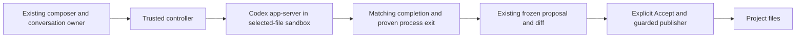

# Managed Codex conversation and review

Date: 2026-10-19. Proposed design for
[ISQ-491](https://linear.app/isqrd/issue/ISQ-491/bring-codex-into-drafts-managed-conversation-and-pre-write-review).
Base: `bba5c4bfda8f1f779348bd5b776235924a07c90d`.
Branch: `feat/isq-491-managed-codex`.

This is a design for review, not shipped support or an approved implementation
plan. Protocol discovery succeeded; command confinement inside the existing
outer sandbox has an unresolved host compatibility gate. See the
[preflight evidence](../../validation/2026-10-19-codex-app-server-preflight.md).

## Intended result

Use Codex from Draft's existing composer. An explicit Send starts a managed
turn against copies of selected saved files. Text and progress reach the chat.
After a valid completion and proven process exit, Draft freezes the proposal
and presents its existing diff. Accept publishes through the existing guarded
writer; Reject leaves project bytes unchanged. Edit/Freeze corrections remain
local actions with no model request.

The first end-to-end acceptance case edits one saved file. Reuse the existing
1–16 file / 1 MiB selection limits rather than adding another selection model.
Follow-ups must retain the same Codex thread across stopped workers. Do not
describe independent calls with replayed text as conversation continuity.

The purpose of the
[claudecode.nvim study](https://linear.app/isqrd/document/claudecodenvim-study-architecture-diff-review-and-lessons-for-draft-7658617adef7)
is Codex/OpenCode integration: explicit editor context, correlated requests,
review lifecycle, byte fidelity and editor ownership. Claude's WebSocket/MCP
wire protocol and login are not prerequisites. ISQ-462 remains the separate
shared context-management follow-up; ISQ-463 remains an optional comparison.

## Approach

| Option | Consequence |
| --- | --- |
| Codex app-server over stdio | Recommended: explicit thread/turn identities, streamed items, interruption and documented client protocol. Fits the existing supervised controller. |
| `codex exec --json` or its SDK wrapper | Useful for a bounded subprocess task, but would require more inference around managed conversation state and client requests. Not the selected interface. |
| Native Codex terminal | Keep its existing behavior. Its after-write review cannot supply this feature's approval-before-project-write contract. |

Start with the installed **Codex CLI 0.163.0** and its locally generated stable
JSON schemas. Do not assume compatibility with every later version or copy
today's website examples verbatim: the installed `thread/start` sandbox enum
uses `workspace-write`, while `turn/start.sandboxPolicy.type` uses
`workspaceWrite`. Probe the configured executable on explicit Send, validate
its identity/version, and refuse a mismatch without a native fallback.



## Files and interfaces affected

| Boundary | Minimum required change |
| --- | --- |
| `lua/ai/init.lua`, `lua/ai/chat.lua` | Select trusted managed-chat configuration; preserve the runtime lease and existing commands. |
| `lua/ai/conversation_controller.lua` | Resolve the selected executable, validate backend-specific options, and pass a closed private launch configuration. |
| `lua/ai/conversation.lua`, `chat_view.lua`, `lua/draft/health.lua` | Carry immutable backend identity and show truthful labels, startup errors and readiness. Preserve action/review state transitions. |
| `scripts/nvim-ai-conversation.py` | Choose between two concrete turn/store implementations from trusted configuration. Agent messages cannot select the backend. |
| `scripts/nvim-ai-acp-worker.py` | Reuse bounded I/O and process supervision with an explicit Codex envelope mode and notification polling after an RPC response. Preserve strict ACP behavior. |
| New Codex turn and store helpers under `scripts/` | Own app-server semantics, isolated profile construction and Codex-specific retained state. |
| Existing staging, review registry and publisher | Reuse source snapshots, staging, frozen manifests, revisions, receipts, correction buffers and publication guards directly. |
| Tests, fixtures, README and `doc/draft.txt` | Add Codex protocol/confinement coverage and setup examples; keep the existing OpenCode cases. Capture the changed backend label in the UI. |

Do not add a backend plugin registry, a second chat UI, a second publisher, or
generalize OpenCode's database whitelist to accept arbitrary Codex files.
Extract common lifecycle logic only where the concrete second adapter needs it.

## User configuration

Add an optional `chat` setup table. Omitting it preserves today's OpenCode
configuration through `staged.conversation_options()` and saved staged
preferences. An explicitly supplied chat configuration is complete; it does not
silently inherit OpenCode credentials or provider settings.

Proposed shape, not usable on the base commit:

```lua
require("draft").setup({
  chat = {
    backend = "codex",
    model = "openai/<advertised-codex-model>",
    auth_file = "/absolute/path/to/codex/auth.json",
    -- codex = "/absolute/path/to/codex",
  },
})
```

Retain the existing `provider/model` value in the conversation owner; the Codex
adapter accepts the `openai` prefix and translates to the advertised Codex model
identifier at its boundary. Validate `model/list` results and the selected model
returned by thread start/resume. No silent model substitution or cross-provider
switch. Reuse `:NvimAIChatModel` for subsequent explicit turns.

Backend identity is fixed for an owning conversation. Setup, opening/hiding
chat, status and health do not submit a prompt, initiate login, or open credential
contents. Runtime readiness and model discovery occur on explicit Send. Keep
native backend selection and standalone staged preferences compatible; do not
change the native Codex capability record to advertise managed-chat abilities.
No new backend-picker command or persisted settings migration in this slice.

## Confinement and credentials

Retain Draft's fresh Bubblewrap filesystem: only selected copies appear at
`/tmp/project`; the actual project, editor socket and trusted proposal directory
are absent. System runtime mounts remain read-only, and worker PID/lifetime
ownership stays with the controller. Source drift, extra paths, links, file-type
changes and byte/mode changes continue through the existing staging checks.

Codex commands additionally require its supported `workspaceWrite` sandbox with
network access disabled, `/tmp` and `TMPDIR` excluded from implicit writable
roots, and only the disposable project writable. Use approval policy `never`
and reviewer `user`; deny unexpected requests for command escalation, broader
permissions, client tools or session-wide grants. Codex edits in the disposable
workspace are not approval to publish project files. Provider-reported patches
and completion text never replace the stopped filesystem snapshot.

The engine needs provider connectivity in a real turn; command subprocesses do
not. Do not confuse the network-disabled discovery probe with that production
network arrangement. Verify command network denial independently in the actual
configured sandbox before enabling the managed backend.

Use a generated isolated Codex profile, not the user's global/project config.
Disable bundled skills, plugins/MCP, subagents, memory generation, web search,
shell snapshots, updates and analytics for this bounded workflow. Verify the
pinned profile's effective behavior; merely finding an option in a schema is
not acceptance evidence.

On first Send, securely load only the explicitly configured Codex credential
file and the supported OpenAI authentication form. Support an API key or saved
ChatGPT login tokens through Codex's file credential store; reject unrelated
credential types and keyring-only profiles with a truthful setup error. The
original credential file stays unchanged. A private writable copy belongs to
this conversation, so Codex can refresh that copy across its turns. Do not
export refreshed credentials, copy user configuration, log tokens or start a
login flow. Token refresh and account access need opt-in real-account validation;
source inspection alone does not prove them.

## Codex state ownership

Implement a separate store using the existing ownership principles: a new
private root, no adoption, metadata-only inspection of backend state, bounded
entries/bytes, live checks, and a stopped-state seal before reuse. Only the
owning controller may launch a worker against it. Reap before seal, freeze,
reuse or deletion. Unknown/forced exit taints continuation.

The initial probe creates several SQLite databases, a writer-lock directory,
markers and scratch helper directories even without a model turn. Completed
threads also need persisted rollout state. Finalize a closed artifact policy
against a successful pinned-runtime turn/resume test; do not infer it from the
three-file OpenCode whitelist or allow every file matching a broad suffix.

Keep 64 MiB retained-state budget, at most 4096 entries and depth 8. Retained
directories must be owned mode 0700; payload files owned, single-link regular
files mode 0600. The observed nonsecret `installation_id` marker may be mode
0644 only at its exact root-relative name behind that private root. Do not
accept that mode for credential, rollout or database files. Writable helper
aliases, caches and bundled code belong to disposable scratch mounts, not the
retained payload. Refuse unexpected entries rather than repairing them silently.

Keep credentials separate from general artifact inspection: validate their
bounded private file at import, retain the copied file as owned state, and never
include its bytes in diagnostics. Close removes proven-owned state after exit;
unsafe cleanup remains visible for explicit recovery.

## Protocol and lifecycle

1. Initialize once, validate the pinned runtime, then send `initialized`.
2. Create a thread, or resume the exact previously completed thread with the
   same isolated profile and a fresh selected-file workspace. Validate returned
   cwd, model/provider and effective permissions before sending the prompt.
3. Mark submission uncertain as soon as writing `turn/start` begins; never
   replay it automatically. Bind the returned thread and turn identities to
   Draft's existing conversation/owner/worker generation fences.
4. Map bounded `item/agentMessage/delta` and selected item progress into the
   existing text/progress events. Handle events arriving before the
   `turn/start` response with a bounded queue and validate identity before
   exposing them. Acknowledging `turn/start` is not completion.
5. Require matching `turn/completed` with status `completed`, then settled
   process exit, store validation, current source snapshots and the existing
   freezer before exposing review. A discussion-only turn creates no proposal.
6. On explicit Cancel, call `turn/interrupt` for the current thread/turn.
   Its RPC acknowledgement is insufficient: require matching terminal
   `interrupted` plus exit/state evidence for eligible continuation. Otherwise
   discard mutable output and report recovery truthfully.

Codex frames omit ACP's mandatory `jsonrpc` member. Observed notifications also
carry `emittedAtMs`. Validate an explicit Codex envelope without loosening ACP
validation. Ignore permitted additive response data only outside authority
checks; retain duplicate-key, identity, depth, frame and byte budgets. A stream
pump must remain responsive when no RPC is pending because completion is an
asynchronous notification. Keep existing absolute startup/generation/cancel and
shutdown deadlines; output never renews them.

An empty newly created thread is not resumable: 0.163.0 refuses it before the
first user message materializes its rollout. Do not store a thread ID alone as
proof of resumability. A pre-submission failure may permit a later explicit
retry only with positive cleanup evidence and no submitted prompt; a failed
resume never triggers a new thread or transcript replay automatically.

Revisions use the existing pending workspace seed and receipt-derived accepted/
rejected context. Manual corrections must reach the next explicit Codex message
as current editor-owned state. Previously published/rejected files are not
silently made editable again. Broader context attachment remains ISQ-462.

## Compatibility gate before implementation exposure

The tested host starts app-server in the outer sandbox, but a sandboxed local
`command/exec` fails before running its assertions because another namespace
cannot be created. Nested system Bubblewrap alone reproduces this failure.
The legacy Landlock option also fails: the pinned runtime explicitly requires
Bubblewrap for filesystem-restricted app-server socket isolation.

The next executable milestone is to pass the same disposable command probe on
a supported launcher/host while retaining both policy layers. It must prove:
workspace write succeeds; private Codex state and outside-workspace writes are
denied; command network sockets are denied; the host project is absent. Then
add the same confinement assertions to the real-runtime acceptance test.

Do not disable host policy, switch to `externalSandbox`/full access, drop a
sandbox, or treat a startup handshake as this proof. If the current host remains
unsupported, report it as unsupported and use an explicitly suitable validation
environment. Offline adapter development is possible, but Codex must not be
advertised as ready without the positive runtime proof.

## Acceptance and delivery

- Offline fixtures cover actual Codex envelopes, additive timestamps, interleaved
  events, wrong thread/turn/item IDs, duplicate terminal messages, malformed and
  oversized frames, blocked writes, EOF, cancellation and lost responses.
- Store tests cover allowed lifecycle changes, tampering, links/modes/ownership,
  budgets, missing rollouts, forced exits and refused cleanup. Verify completed
  thread resume with the installed pinned CLI and a synthetic local provider.
- A real headless Neovim path drives composer, isolated edit, frozen diff,
  accept/reject, source drift, follow-up, and manual Edit/Freeze. Assert exact
  project bytes before approval and after publication, including existing CRLF
  and final-newline guarantees.
- Reuse OpenCode and public setup/status tests as regression coverage. Existing
  configurations must work without Codex installed; Codex-only configuration
  must not require OpenCode. Opening UI/health must remain passive.
- Run the normal suite and Lua formatting checks after implementation, review
  the whole change, and record exact-head CI. UI label changes need a capture.
- Real-account Codex editing is an opt-in final acceptance step with a stated
  credential source and disposable file. No Claude login is involved. No such
  request has run during this design investigation.

Keep the approved spec and eventual implementation plan on this feature branch
and include them with the implementation PR. Do not create a plan-only PR or
additional overlapping Linear issues. Update ISQ-491 with evidence and leave
its implementation acceptance open until it is actually demonstrated.
