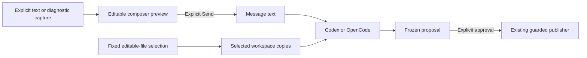

# Read-only context for managed conversations

Date: 2026-10-21. Revised and approved 2026-10-23 after independent review. Contract for
[ISQ-462](https://linear.app/isqrd/issue/ISQ-462/define-read-only-context-attachments-independently-of-editable-scope).
Base: `48ea226505309ea04160bcc30fe6ea42259b34a9`.
Branch: `feat/isq-462-readonly-context`.

Status: approved by the user for implementation planning on 2026-10-23; not
implemented. The [implementation plan](../plans/2026-10-23-readonly-context.md)
stays on this branch with the implementation PR and awaits its execution review.
No separate plan-only or design-only PR is proposed.

## Intended result

While asking Codex or OpenCode to edit selected saved files, a user can attach
text or diagnostics from another file in the same project. The agent receives
the attached snapshot as conversation text. The attachment gives it no new
filesystem access or permission to publish changes.

The requested constraints are fixed editable scope, explicit add/preview/remove,
no provider work until Send, and reuse of Draft's composer and guarded publisher.
The approved first version includes unsaved text from named file buffers.
Capturing context does not save those buffers.

Example: select `src/parser.lua` for editing, then attach an unsaved selection
from `src/types.lua`. The prompt contains the selected text from `types.lua`;
only `parser.lua` is copied into the worker workspace or admitted to publication.

## Approach and alternatives

| Approach | Consequence |
| --- | --- |
| Extend the existing text-in-composer attachment | Selected. The composer is the preview and editor; message text and selected-file authority already travel separately. No new protocol or attachment store. |
| Add structured attachment records and a management panel | Would enable individual refresh/removal controls, but adds identity, persistence and retry semantics before they are needed. |
| Mount additional read-only files into the worker | Gives tools file access and expands sandbox/resume policy. A path mention alone must not do this; defer until a separate use case requires it. |

Use explicit snapshots, not automatic selection broadcasts, filesystem watchers,
or agent callbacks into Neovim. The claudecode.nvim lesson is easy context capture
separate from submission; its live IDE protocol is not needed here. See the
[completed study](https://linear.app/isqrd/document/claudecodenvim-study-architecture-diff-review-and-lessons-for-draft-7658617adef7).

This proposal is grounded in the current [attachment coordinator](../../../lua/ai/chat.lua),
[composer limit](../../../lua/ai/chat_view.lua), [saved-source guards](../../../lua/ai/staged_sources.lua),
[closed controller protocol](../../../scripts/nvim-ai-conversation-protocol.py),
and the concrete [OpenCode](../../../scripts/nvim-ai-conversation-turn.py) and
[Codex](../../../scripts/nvim-ai-codex-turn.py) message paths.

## User actions and presentation

| Action | Proposed behavior |
| --- | --- |
| `:NvimAIChatAttach` | Attach the current named file buffer's text. This intentionally changes today's no-range refusal into a whole-buffer action. |
| `:[range]NvimAIChatAttach` | Attach whole lines from that buffer. Preserve existing range behavior. |
| Visual `<leader>at` | Preserve exact character, line and rectangular selection capture, including exclusive selections. |
| `:[range]NvimAIChatDiagnostics` | Attach cached diagnostics whose starting line falls inside the inclusive range; without a range, use the current buffer's diagnostics. |
| Preview, edit, remove | Focus the existing composer. Read, edit, delete or undo the inserted text with normal Neovim operations. There is no hidden attachment queue. |
| Send, Retry, Hide, Close, New | Retain their existing state and confirmation rules. Attachment never invokes any of them implicitly. |

Adding context requires an existing eligible managed conversation. Closed,
closing or recovery-required owners refuse it. An active model turn does not
prevent preparing a later draft; the existing owner still decides when Send is
permitted. Capture adds no new default keymap and never loads an arbitrary path
argument, starts a provider, imports credentials or requests diagnostics.

Change the chat header from `Scope:` to `Editable files:`. Each inserted block
names the project-relative source, captured line span, capture kind, UTC capture
time, and whether the buffer was modified. Label it `Read-only context snapshot`.
For visual selections, distinguish character, line and block selection; the line
span alone must not imply that entire lines were captured.

The label means the attachment grants no authority. A source already listed in
`Editable files` remains editable because of that existing selection. The notice
must say that no editable files were added and only explicit Send submits.

## Text capture and attribution

Capture only the current loaded, named, normal file buffer inside the conversation's
pinned physical project root. Reject terminal, help, scratch, unnamed, outside-root,
binary and non-UTF-8 buffers. Require canonical paths without symbolic-link
components, consistent with selected-source identity. A named new file is allowed
when its nearest existing ancestor is canonical and inside the root; no file is
created. Refuse unresolved or ambiguous paths. JSON-quote the relative source name
in the block; do not interpret literal `$`, spaces or percent signs as expansion.

The source is always editor-buffer text, whether modified or not. An unmodified
buffer is not proof that disk contents are current. Do not reread, reload, save or
claim a disk snapshot. Preserve Neovim's buffer text and the existing visual-region
semantics. Whole-file capture preserves its final-newline flag; text is represented
with LF line boundaries, so CRLF file buffers are explicitly labeled as buffer
snapshots, not byte-for-byte disk copies. Literal CR, NUL, invalid UTF-8, DEL and
control characters other than tab/LF in the captured content are refused.
An empty whole buffer is representable; an empty visual selection is refused.

Use the existing dynamic Markdown fence rule so captured backticks cannot end
the displayed block. A metadata field never becomes a path to load or a tool
instruction. User edits to a block are ordinary prompt text, not trusted provenance.

Snapshot the buffer identity, changedtick and capture-relevant buffer/window
options. Selection preflight and extraction must use the same window context and
options, including those affecting virtual columns and padding. After
opening/focusing the composer, recheck those values, canonical source identity,
conversation owner/revision and composer stamp before appending. A conflicting
autocommand, source edit, rename, close or owner replacement refuses the whole
operation and preserves the draft. After a successful append the text is immutable
with respect to its source: later source changes do not refresh or invalidate it.
The user removes and reattaches it to obtain a newer snapshot.

The saved-source guards for editable files remain unchanged. If an attached
buffer is also editable and has unsaved changes, Send is still refused until the
existing selected-source requirements are satisfied. Unsaved context from a
noneditable file does not enter those writer guards.

## Diagnostic snapshots

On the explicit diagnostic action, use `vim.diagnostic.count(bufnr)` to sum all
cached records across every namespace for the current buffer. Refuse a cache with
more than **1,000 records before calling `vim.diagnostic.get(bufnr)`**, even when
only one record would match the requested line range. A smaller range cannot
bypass this whole-cache limit; the user must reduce the cached diagnostics or
attach relevant text instead. Zero cached records needs no retrieval.

For an eligible cache, call `get(bufnr)` once, then filter by starting line and
serialize the allowed fields. Count and retrieval run synchronously without
yielding, opening the composer or requesting fresh diagnostics between them.
Refuse API errors, invalid counts or a returned count inconsistent with preflight;
do not retry acquisition automatically. Use the same named-buffer/root rules as
text capture. Include all cached namespaces for that buffer, not every buffer in
Neovim, and make no LSP or linter request.
The API exposes cached records with positions and producer information; it does
not provide a general guarantee that they match the current buffer version.
[Pinned Neovim diagnostic API](https://github.com/neovim/neovim/blob/v0.12.4/runtime/doc/diagnostic.txt).

This acquisition policy limits record count, **not total allocation or latency**.
In Neovim 0.12.4, `count` traverses the cache and builds a temporary list of record
references. `get` then deep-copies eligible records, including arbitrary nested
`user_data`, before Draft can discard fields. Even one record can contain a large
nested payload. The first version accepts this public-API limitation; omitting
fields from the outgoing message does not prevent their local acquisition cost.
Document the limit in both usage documents. A hard allocation ceiling would need
a different acquisition design and is outside this slice.
[Pinned count/get implementation](https://github.com/neovim/neovim/blob/v0.12.4/runtime/lua/vim/diagnostic.lua#L1494).

Label every block `Cached diagnostics; freshness unverified`, even for an unmodified
buffer. Include capture time and buffer-modified state. Source changes after capture
leave the block unchanged. Start-line range filtering is intentional; it does not
claim to select every diagnostic whose end position overlaps the range.

Serialize only one-based start line and byte column, severity, optional source/code,
and message. Omit `user_data`, related documents, code actions and arbitrary nested
producer payloads. Diagnostic paths mentioned in messages remain inert text. Validate
record types and text; sort by start position, severity, source, code and message
for stable output. A missing source/code is omitted, not invented. Stale positions
beyond the current buffer remain labeled historical positions, not clamped to
different lines. Negative or otherwise malformed positions are refused.

No matching diagnostics produces a local notice and leaves the composer unchanged.
Oversized or malformed sets are refused atomically; do not silently drop records.
The diagnostic block does not implicitly attach source text. The user can attach
that separately with the text action.

## Bounds and failure behavior

- Keep the existing **32,768-byte complete message limit**, including the user's
  draft, metadata, fences and every context block. Budget UTF-8 bytes, not characters.
  Refuse overflow before changing the composer; never truncate an attachment.
- Bound the enclosing source-line span to **1 MiB before materializing its text**.
  Whole-file capture uses the same ceiling; a smaller range from a large file may
  still fit. A tiny rectangular selection spanning more than that source budget
  is refused with guidance to select fewer lines. Do not scan an unbounded buffer
  merely to discover that the final message is too large.
- Before `getregion()` or equivalent visual text extraction, independently prove
  that the **expanded selection fits 32,768 bytes**. Count selected UTF-8 bytes,
  virtual padding, partial tab/wide-character replacement spaces and line
  separators, including a linewise trailing newline. Source bytes alone do not
  bound this expansion. Reject an excessive row count before enumerating region
  positions; even empty rows require separators. Use bounded position metadata
  such as `getregionpos(..., { eol = true })` or equivalent nontext accounting.
  Stop as soon as the budget is exceeded; never allocate padding just to measure
  it. If the size cannot be established safely, refuse and ask for a smaller
  selection. Accepted captures retain exact visual semantics. The complete-message
  check still applies after adding the draft, metadata and fences.
- Apply the separate **1,000 cached-record acquisition cap** above before reading
  diagnostic payloads. Bound output to **100 matching records**, then apply the
  same complete-message byte limit. These are fixed first-version limits, not new
  setup options. A smaller explicit line range can resolve an output-count refusal
  only when the whole cache is eligible. Neither record cap is a byte limit on
  Neovim's temporary diagnostic data.
- Retain the existing 1 MiB encoded command, 64-turn and 32 MiB conversation limits.
  The normal exact-envelope preflight remains in force after context is appended.
- All refusals preserve the existing composer and source buffers. They must not
  change selection, create a provider session or taint an otherwise usable owner.

## Backend and publication boundary

No new attachment field is added to the editor/controller protocol. The existing
`message` contains the visible draft and snapshot text; `selection` and `sources`
continue to identify only editable files. Both supported managed backends already
consume that message as text. Their fixed prompt preamble should explicitly state
that referenced context paths grant no file access or extra editing authority.

Do not add snapshots to workspace preparation, manifests, source fingerprints,
review registries or publisher inputs. Do not mount their source files, add file-read
callbacks, expose editor sockets, or change either backend's sandbox policy. An
agent can reason from the provided text but cannot use an unselected path to obtain
more bytes. Text labels are explanatory; actual authority remains enforced by the
workspace and publisher boundaries.

This feature applies to managed Codex and managed OpenCode. Native terminal modes
and their existing context commands are unchanged; they do not inherit this
managed guarantee. Unsupported runtime/version failures keep the existing refusal
behavior, with no fallback to native execution or a wider filesystem view.

## Lifetime

Before Send, context lives only in the ordinary composer and survives Hide/reopen.
Edit/delete/undo removes it from the next outgoing message. Successful local
submission clears that draft under the existing rules, even when the outcome later
becomes uncertain; only the existing proven-safe Retry path may resubmit it.
No source recapture, automatic retry or attachment replay is introduced.

After Send, the exact message is part of the existing bounded transcript and may
remain in the backend's conversation state. Later drafts do not automatically
append it again. Deleting later text cannot retract information already submitted.
Completed Close retains the existing read-only local history/unsent composer and
uses the existing private-store cleanup; it does not promise provider-side erasure.
New requires the current close and unsent-draft confirmations, then starts with an
empty composer and no inherited attachment set. Editor exit adds no archive or
attachment recovery store.

## Implementation reach and acceptance

| Existing boundary | Required work |
| --- | --- |
| New `lua/ai/chat_context.lua`; existing `lua/ai/context.lua`, `lua/ai/chat.lua` | Put source/expanded-text preflight, diagnostic count preflight and rendering in one chat-specific helper. Reuse exact visual capture after preflight and expose the existing physical-source resolver from `ai.context` for shared path resolution. The chat coordinator keeps owner/composer race checks. Saved-source capture and native delivery lifecycle stay unchanged. |
| `lua/ai/chat_view.lua`, `lua/ai/init.lua` | Preserve atomic composer append, clarify editable files, register diagnostic action and whole-buffer attach behavior. |
| Both concrete turn adapters under `scripts/` | Clarify the fixed context/authority preamble; preserve message transport and all sandbox/publication interfaces. |
| Existing selection, chat, backend and UI fixtures | Verify unchanged authority as well as displayed text. Add focused capture cases and a diagnostic fixture using synthetic data. |
| `README.md`, `doc/draft.txt`, validation record | Document both actions, unsaved/snapshot limits, the diagnostic acquisition limitation and native-mode distinction; capture the changed composer/header in Neovim. |

The implementation must demonstrate:

1. Attach an in-root, unselected file/range, preview/edit/remove it, and observe zero
   provider requests until explicit Send. Both backends receive only the visible
   message; selected workspace paths and publisher inputs are unchanged.
2. Attach an unsaved/new named buffer without saving it. Changing it afterwards does
   not mutate the draft. Dirty editable sources still block Send through the old guard.
3. Preserve character/line/block and exclusive visual selections, non-ASCII content,
   empty whole files, missing final newline, CRLF buffer representation and embedded
   fences. Refuse invalid text without partial insertion.
4. Refuse outside-root and symlink paths, special/unnamed buffers, and capture races
   involving buffer edits, renames, composer autocmd edits or owner replacement.
5. Test combined-message boundaries at 32,768 bytes, metadata overhead, multibyte
   overflow and the 1 MiB source-span bound. Verify virtual padding, partial tabs,
   wide/combining characters, exclusive selections and large row counts against
   the expanded-text preflight. The review's 100-line, 200-source-byte selection
   expanding to 100,199 bytes must refuse before calling `getregion()`. Assert
   that refused captures leave the composer intact and do not materialize the
   oversized region; checking only the final error is insufficient.
6. Capture multiple diagnostic namespaces, line-filter them, preserve source/code
   and cached-freshness labeling even for positions beyond the current buffer, and
   omit nested payloads. Empty or malformed sets leave the draft intact; later
   diagnostic/source changes do not alter an already inserted snapshot.
7. Exercise pending-review follow-up, safe retry, Hide, Close and New with snapshots.
   Prove no automatic resubmission, fresh read grant, scope expansion or unselected
   publication occurs, including for malicious path-like text inside an attachment.
8. Test exactly 1,000/1,001 cached diagnostics with only one range match. Above the
   acquisition cap, assert zero `get` calls and no composer change. For eligible
   caches, test 100/101 matching records, count/retrieval failure or disagreement,
   and a small synthetic nested payload to show that it is copied by Neovim but
   omitted from serialization. Do not claim a hard acquisition-memory bound from
   these tests or stress the editor with a huge payload.

Use the isolated test runner and synthetic providers. Existing installed-runtime
evidence covers the unchanged sandbox implementation; text plumbing tests must
show no additional path enters either backend's workspace. No real-account login
or paid provider request is needed to establish this contract.
