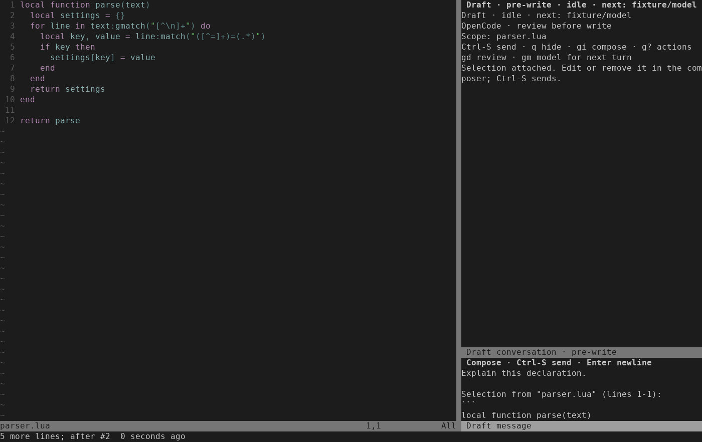

# Selection context — 2026-10-16

[ISQ-459](https://linear.app/isqrd/issue/ISQ-459) adds an explicit way to put
selected saved text into the existing chat composer. Tested from base
`5b447c0aa553e86e103492ecea899d494e407cae` on
`feat/isq-459-selection-context` with this branch's implementation and tests.

`:[range]NvimAIChatAttach` captures whole lines. With global mappings opted in,
Visual `<leader>at` captures character, line or block selections. Both append the
relative path, line range and selected text without replacing an unsent draft.
The attachment is ordinary editable prompt text, bounded by the existing 32 KiB
composer limit. It is a snapshot at capture time; later source edits do not
update it automatically.

Only files already selected for the conversation are eligible. Saved-source and
alias checks run before capture, disk bytes must match the buffer, and source,
conversation revision and draft are checked again after focus changes. Dirty,
stale, invalid, oversized and out-of-scope context is refused without saving a
source or expanding edit permissions. The existing explicit Send remains the
only submission path.

## Keyboard walkthrough

1. Open `:NvimAIChat` from a selected saved file. Type an unsent question in the
   composer, then press Escape and `q` to hide chat.
2. Select text with `v`, `V` or Ctrl-V and press `<leader>at` when
   `require("draft").setup({ keymaps = true })` is enabled. Without those mappings,
   use a line range such as `:12,20NvimAIChatAttach`.
3. The composer regains focus and retains the question above the labeled text.
   Edit or delete the context normally. `u` removes the attachment and Ctrl-R
   restores it. Hiding and reopening chat retains the draft.
4. Press Ctrl-S, or run `:NvimAIChatSend`, to submit. Attaching alone launches no
   provider and sends no prompt. A pending proposal remains deferred during
   attachment; explicitly opening chat can then present its diff.

The real-key TUI test performs this sequence with a deterministic in-process
provider. The production-controller test independently observes the exact
attached prompt on the real confined ACP route only after explicit Send.

## Verification

- The new public-flow test first failed because the command did not exist.
- Focused coverage includes UTF-8, character/line/block and exclusive selection,
  embedded backticks, preserved drafts, scope/dirty/stale/size refusal, focus-time
  source mutation and closed-history refusal.
- Real terminal keys verify focus, undo/redo, hide/reopen and explicit Send.
- Independent review found no blocking defect. Its deferred-review focus probe
  was retained in `ai_chat`: scheduled ModeChanged callbacks cannot open a diff
  or dispatch a decision during attachment, while explicit reopening still works.

```sh
python3 -I -B tests/run.py ai_chat_selection ai_chat_controller nvim_ai_chat_ui
python3 -I -B tests/run.py ai_chat
python3 -I -B tests/run.py
stylua --check lua tests
git diff --check
```

The final default run passed **64/64 suites**, including all ten real-key TUI
cases and relocated-install coverage (`.test-results/run-iqcp2cum`). Formatting
and whitespace checks passed. Environment: Neovim 0.12.4, Python 3.14.4, Linux.
An earlier run passed 63/64 suites: the unchanged `ai_conversation_driver` duplicate-output flood case
exceeded its three-second phase wait. Isolated runs passed on both this branch
and unchanged main. No production timeout or test deadline was changed.

The terminal capture below was rendered from actual cells and visually inspected.
No live provider/account, installed-OpenCode compatibility run or daily-use
friction assessment was performed. Those claims are not inferred from fixtures.


