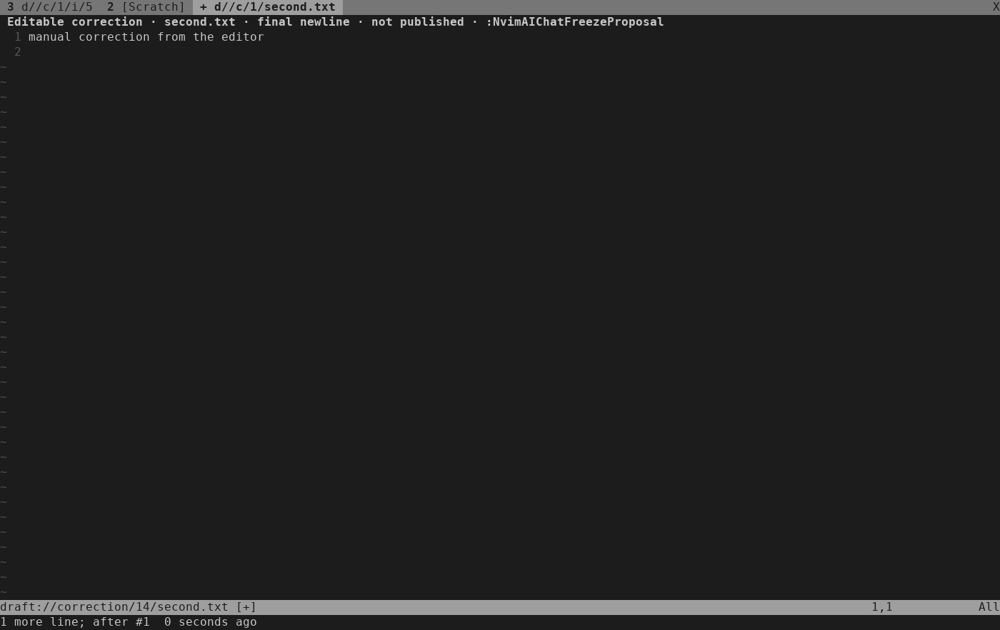
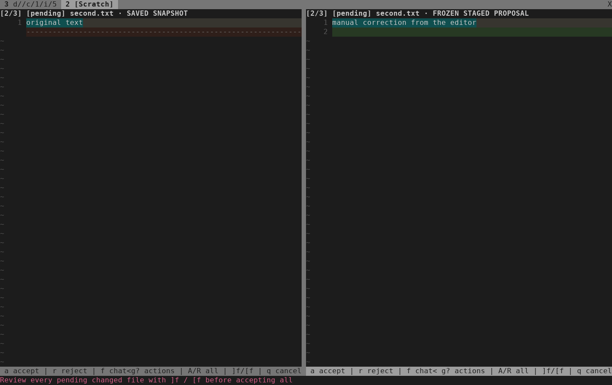

# Manual proposal corrections — 2026-10-17

[ISQ-461](https://linear.app/isqrd/issue/ISQ-461) implements the
[approved correction design](../superpowers/specs/2026-10-17-manual-corrections-design.md)
on `feat/isq-461-manual-corrections`, from main
`90432f510cd1ddeb8321004a986f140fe2d3da37`. The
[implementation plan](../superpowers/plans/2026-10-17-manual-corrections.md)
travels with the feature.

A visible pending proposal can be copied into a separate editable scratch.
Explicit Freeze creates a fresh frozen revision through the existing registry
and durable retirement path. Normal approval remains the only project publisher.
Neither Edit nor Freeze creates a model turn. Prior accepted/rejected files stay
confirmed context, and a replacement requires fresh visits to every pending file.

## Keyboard walkthrough

1. Send a request for three selected saved files. Accept the first proposal with
   `a`, leaving the second and third files pending.
2. From the second frozen diff, press `g?` and choose **Edit proposal** (also
   available as `:NvimAIChatEditProposal`). Replace the text
   using ordinary keys and add a trailing blank line. Undo and redo the edit.
   The buffer says **Editable correction**, **final newline**, and **not published**.
3. Press `g?` and choose **Freeze proposal** (or use
   `:NvimAIChatFreezeProposal`). The token changes, revision becomes 2, the
   first file stays accepted, and the second project's saved file is unchanged.
   The new frozen second-file diff opens. Batch acceptance still refuses because
   the third file has not been visited in this revision.
4. Press `a`. Only then does the second file contain exactly
   `manual correction from the editor\n\n`; the first keeps `proposed edit\n`, and
   the third keeps `original text\n`. There is still one real model turn and one
   ACP prompt. Chat labels the revision as a manual correction.

`ChatApprovalUITest.test_manual_correction_freezes_then_publishes_only_after_review`
performs this with actual terminal keys, a production controller, confined fake
ACP peer and the existing publisher. Its two captures below were rendered from
real terminal cells and visually inspected at 140 columns. An initial assertion
expected an unwrapped transcript label; the test now reads the complete transcript
for that assertion and captures the actual wrapped display separately.




## Boundary evidence

| Boundary | Verified behavior |
| --- | --- |
| Scratch bytes | Zero bytes, one/two newlines, Unicode and trailing blank lines round-trip. Undo/redo works. EOF metadata stays explicit. Invalid UTF-8, BOM/NUL/CR, unsafe options and oversized content are refused. No review decision mappings are installed. |
| Command admission | Exact encoded JSON size, including escaping and envelope, is checked before serial/state mutation. Oversize retains editable text and the original token. Strict protocol fields and duplicate serials cannot replay effects. |
| Registry handoff | No-op keeps token/budget; changed bytes produce a fresh token and retirement proof. Returning to baseline becomes unchanged and can settle the round. Source drift, freeze/retirement/install/cleanup faults cannot reactivate fenced authority. |
| Owner/adoption | Correction gates all publication/follow-up paths. Identity, receipt, captured buffers/aliases and immutable panels remain checked. Model turns and manual revisions have separate 64-operation budgets; no-op works at the manual cap. |
| Lifecycle | Hide/reopen retains text. Cancel during freezing and hidden Cancel/Close preserve editable detached text. Controller loss disables Freeze without replay. Newer text after submission is retained separately; approval applies only the submitted snapshot. Stale discard confirmations cannot erase later edits. |
| Receipts/context | Earlier accepted bytes and rejected outcomes survive replacement. The next actual provider turn receives current selected contents and a bounded manual-correction note. Close preserves terminal blocked/uncertain writer evidence. |

The new registry, protocol, controller, owner and public-action assertions were
run failing before implementation, then passing. Integration checks caught two
ownership edge cases: a lost install reply retained the predecessor lock, and
Close with already-consumed blocked/uncertain authority attempted a second
cancellation. Real-journal regressions now cover both, including replacement
that leaves no pending files.

The scratch uses `acwrite` with no write handler, keeping Neovim's modified/quit
protection. `nofile` was rejected after a probe showed it suppresses the modified
flag. The buffer has no path to the publisher; ordinary buffer writes do not
freeze or approve it.

## Verification

```sh
python3 -I -B tests/run.py
stylua --check lua tests
git diff --check
DRAFT_CHAT_CAPTURE_DIR=/tmp/draft-isq461-captures \
  python3 -I -B tests/nvim_ai_chat_ui.py \
  ChatApprovalUITest.test_manual_correction_freezes_then_publishes_only_after_review -q
```

Environment: Neovim 0.12.4, Python 3.14.4, Linux. Focused registry checks passed
22 tests; all nine named chat/editor suites passed. The actual-key correction
walkthrough passed. The complete default run passed **66/66 suites**, including
all 11 real-key TUI cases and relocated-install checks
(`.test-results/run-_obueoe7`). Formatting and whitespace checks passed.
Installed-agent/live-account checks remained opt-in and were skipped as expected.

No live provider/account, installed-OpenCode compatibility audit or daily-use
benefit assessment was performed. User selection authorized implementation; it
is not evidence of reduced daily friction. Drafts live only in editor memory:
forced deletion or editor exit can lose unsaved text. Existing text/aggregate
limits and the encoded 1 MiB command limit deliberately remain in place.

## Independent review and regression fixes

A fresh whole-branch review found four substantive issues. Each was reproduced
before its fix; all seven scenarios in `ai_chat_correction_edges` failed for the
reported reasons, as did the owner and registry attribution checks
(`.test-results/run-29aq1m15`). The focused fix run passed **7/7 suites**, including
23 registry tests (`.test-results/run-2ipjvq1o`).

- A `BufWinLeave` callback could add newer text after the pre-delete stamp check.
  Discard now rechecks after hiding, detaches newer text, and leaves the submitted
  frozen bytes separate. Regression coverage exercises both Freeze and Discard.
- A missing draft had no stamp, which made every new Cancel/Close confirmation
  stale. Dialogs now compare absence consistently; deletion after opening still
  invalidates the older confirmation, while a fresh confirmation permits cleanup.
- Edit/Freeze menu entries could not be reached from their eligible buffers.
  `g?` now opens the existing actions menu in frozen and editable correction
  buffers. Editable text has no approval keys, and detaching removes the menu
  mapping. The terminal walkthrough exercises the actual menu keys.
- A discussion-only or safely refused follow-up could become a correction's
  false model source. The registry retains the predecessor source generation;
  the owner preserves the original round turn while the current operation
  envelope and manual provenance remain separate.

No minor findings were deferred. The reviewer declined to assess actual daily-use
benefit without user evidence. Implementation was explicitly selected, so that
acceptance item remains open; the risk is delivering a workflow users do not need.

After the review fixes, the full default suite passed **67/67 suites**, including
all 11 TUI cases (`.test-results/run-j5crf_om`). Formatting and whitespace checks
passed. The refreshed editable/frozen captures were visually inspected.

Delivered in [PR #11](https://github.com/ruohao1/draft.nvim/pull/11), open and
unmerged. ISQ-461 is In Review, with the results also recorded in the original
Linear study and design document. The original delivery tested feature/fix code
through `923a6d2`; the follow-up review and verification below cover later changes.

## Follow-up review: final draft cleanup

A user-requested review found one further P2 data-loss case. With a correction
open in two split windows, hiding its original window leaves another view open.
The final buffer deletion can then run `BufWinLeave` after the last draft stamp
check. Text added by that callback was silently deleted. `BufUnload`, `BufDelete`
and `BufWipeout` callbacks had the same gap, including without a second view.

The shared draft cleanup now uses Neovim's `noautocmd` modifier only for final
buffer deletion, after the existing hide-and-recheck step. It removes its own
augroup explicitly because its `BufWipeout` cleanup is also suppressed. Earlier
window-leave edits still detach into editable scratch; final teardown cannot
introduce unseen edits after validation. Normal editor event settings are retained.

All eight new public-command cases (four events through both Freeze and Discard)
failed with `newer teardown edits were deleted` before the fix
(`.test-results/run-n5lb0g9g`). The three focused suites then passed, including
all fifteen correction-edge scenarios (`.test-results/run-gxpgrdaa`). They check
retained text or safe disposal, removal of draft event handlers, unchanged project
bytes until approval, and publication of exactly the intended proposal.

The first full run passed 66/67 suites (`.test-results/run-mlg0z9bb`), with
`EngineTest.test_answer_finishes_without_proposal` failing because the threaded
audit collector recorded `session/new` before `initialize`. A deterministic
localhost probe reproduced the reversal despite correctly ordered sends. The
fixture now numbers requests as received; the test asserts method order using
those sequence numbers rather than collector thread completion. The assertion still
checks the complete method sequence from the peer's actual receive order.

The controller suite passed all 37 tests after that fixture correction
(`.test-results/run-49_00f8v`). The final complete default run passed **67/67
suites**, including all 11 terminal UI cases (`.test-results/run-qvjghft6`).
`stylua --check lua tests` and `git diff --check` passed. Live-provider and
installed-OpenCode checks remain opt-in and were not performed; daily-use benefit
and crash recovery remain outside this validation.
