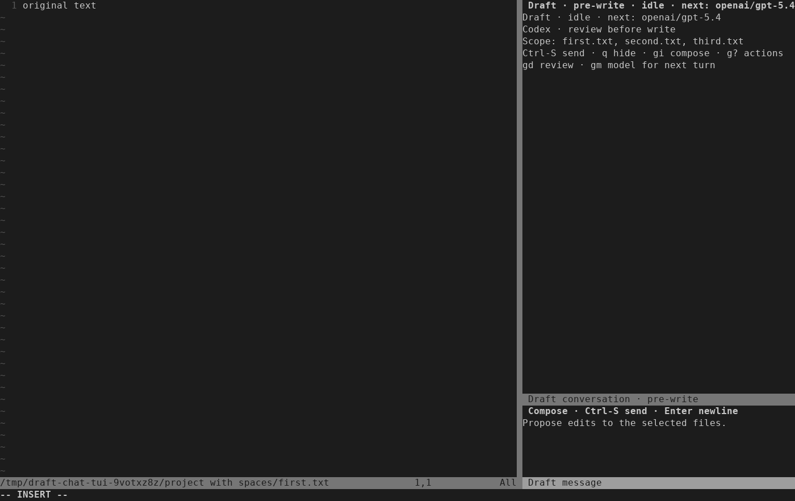
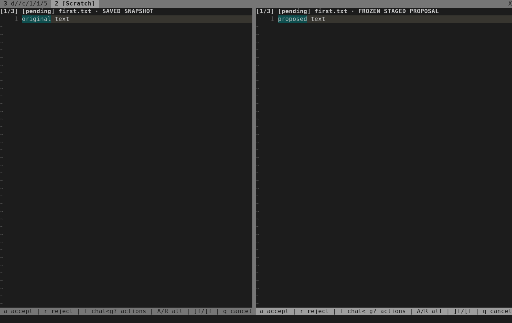

# Managed Codex runtime validation

Date: 2026-10-20. [ISQ-491](https://linear.app/isqrd/issue/ISQ-491).
Managed Codex is implemented behind the complete optional `chat` configuration.
The supported-runner controller audit below is the final runtime acceptance gate.

## Baseline and explicit opt-in

The provider-free baseline at `0fafc251e86a20fe8de3fbb9dce0fda6b22e7f1f`
passed all 67 suites (`.test-results/run-ngzsfu5x`). Optional installed-provider
cases remained skipped. The new runner regression failed for the missing
`--codex` option, then passed after adding the explicit option. It verifies that
ambient Codex opt-in and OpenAI credentials are not inherited, including a
configured executable path containing spaces and non-ASCII characters.

## Installed CLI on the development host

Command:

```sh
python3 -I -B tests/run.py --codex /home/ubuntu/.codex/packages/standalone/releases/0.163.0-x86_64-unknown-linux-musl/bin/codex nvim_ai_codex_runtime
```

Result: the runner regression passed; four installed-runtime cases failed during
setup before any prompt. Each successfully initialized app-server, then
`command/exec` of `/usr/bin/true` returned exit 1 because nested Bubblewrap could
not create a namespace. Log: `.test-results/run-y6vgzvya`.
No command confinement assertion, model edit, cancellation or resume passed on
this host. The failure matches the [earlier preflight](2026-10-19-codex-app-server-preflight.md).
Both sandbox layers and host policy remain intact.

## Disposable Linux CI gate

The existing workflow now accepts an explicit `codex_runtime` boolean input.
Its default remains false. The optional job steps reuse the existing narrow
Bubblewrap AppArmor profile and the same audit. The initial gate required a
completed real-runtime turn and stopped-worker resume before admitting a closed
state-artifact policy; the passing inventories are recorded below.

The [official 0.163.0 release](https://github.com/openai/codex/releases/tag/rust-v0.163.0)
archive was downloaded to temporary storage and verified against published
SHA-256 `beb339e8ecd9ba057a6bb2dc81ad8ca474812edfbf0fc5056ca818797648dde4`.
Inspection found one regular executable, `codex-x86_64-unknown-linux-musl`,
296865480 bytes. No global installation or configuration was changed.

The local fixture follows the pinned upstream
[Responses events](https://github.com/openai/codex/blob/rust-v0.163.0/codex-rs/core/tests/common/responses.rs)
and [command event fixture](https://github.com/openai/codex/blob/rust-v0.163.0/codex-rs/app-server/tests/common/responses.rs).
The isolated profile directs the built-in OpenAI provider to loopback using
`openai_base_url`; only synthetic credentials enter the probes. The outer
network remains available so a passed command denial cannot be explained by
outer network isolation. Actual-account access and refresh are untested.

## First CI attempt

[Run 39472837116](https://github.com/ruohao1/draft.nvim/actions/runs/39472837116)
tested `4b1a9aa5b77fb04b90b86a5dc1e052f48789f76e`. All 68 default suites
passed; the optional runtime audit failed with three fixture failures. Unlike
the development host, the CI runner successfully executed nested sandboxed
commands. A real isolated edit and interrupted terminal event were observed,
with graceful worker exits and 0600 rollout files; resume checks were not reached.

The write-denial probe expected only `PermissionError`, but a read-only mount
correctly returned `EROFS`. The probe now accepts only EACCES, EPERM or EROFS;
unrelated filesystem errors still fail. The provider fixture also treated
Codex's WebSocket upgrade attempts as unexpected GET requests. It now refuses
only the recognized `/v1/responses` WebSocket handshake with HTTP 426, allowing
the observed HTTP fallback; other GETs still fail the audit. Command-to-provider
connection denial is still asserted, alongside a separate socket-creation
denial assertion. Both fixture corrections follow actual CI failures, not
relaxed runtime policy. The complete confinement and resume gate remained open until the corrected
audit passed below.

## Bounded transport implementation

The shared worker now has an explicit Codex wire mode, an idle notification
pump and semantic notification validation during shutdown. ACP remains the
default. Fourteen Codex tests and all nineteen existing ACP tests pass; the full
provider-free run passed 69/69 suites (`.test-results/run-vz2fddtv`).
`stylua --check lua tests` and `git diff --check` also passed.

Coverage includes timestamped/early/late notifications, duplicate terminal
callbacks, disabled client operations, malformed envelopes/UTF-8, byte/frame/
message limits, blocked writes, EOF, idle state checks and absolute deadlines.
A depth regression first failed because Python 3.14 accepts deeply nested JSON;
Codex now checks a depth limit of 32 before parsing, matching the editor limit.
This may refuse future legitimate deeper payloads until compatibility is reviewed.
Transport tests do not establish real-runtime confinement or account access.

## Supported-runner gate passed

[Run 39474588025](https://github.com/ruohao1/draft.nvim/actions/runs/39474588025)
tested `c0db8bc947bff7666e4bc0c808125c9481e3c6d9`. All 68 default suites
passed, followed by all five explicit Codex audit tests (34.468 seconds, zero
skips). The downloaded log `run-dvvizwkw/nvim_ai_codex_runtime.log` records
completed edit, resumed thread, empty thread/refused resume, interruption,
resume after interruption, and confinement inventories.

The full probe demonstrated selected-workspace writes, denied private-state and
outside-workspace writes, denied network socket creation and provider
connections from commands, and absent host project/editor socket. The engine
successfully reached the local provider. Both sandbox layers stayed enabled.
The native CLI edited only the selected copy; source bytes remained unchanged.
Completed and interrupted threads resumed with their original thread IDs after
workers exited. Empty-thread resume remained the expected -32600 failure.

Observed retained root entries were `auth.json`, `config.toml`,
`.sandbox_migration`, `installation_id`, `sessions`, `thread-writer-locks`, `tmp`,
and these six exact database families with optional `-wal`/`-shm` sidecars:
`goals_1.sqlite`, `logs_2.sqlite`, `memories_1.sqlite`, `queue_1.sqlite`,
`state_5.sqlite`, `thread_history_1.sqlite`. Rollouts appeared under
`sessions/YYYY/MM/DD/rollout-YYYY-MM-DDTHH-MM-SS-<thread-uuid>.jsonl`.
Writer-lock inventory contained `.coordination.lock`; stopped helper scratch
contained `tmp/arg0-linux`. Directories were 0700 and regular files 0600 except
exact root `installation_id` (0644, 36 bytes). All regular files had one link.

| Stopped state | Entries | Regular-file bytes |
| --- | ---: | ---: |
| Completed edit | 31 | 3583046 |
| Resumed completed thread | 25 | 3406496 |
| Empty thread | 23 | 2706350 |
| Empty resume refused | 22 | 2780078 |
| Interrupted turn | 31 | 3471977 |
| Resumed interrupted thread | 31 | 4016639 |
| Confined completed turn | 31 | 3452232 |

The two successful resumes grew the existing rollout files rather than creating
replacement thread identities. These are discovery-harness results with a real
CLI and synthetic provider. The production store/turn/controller still need the
same acceptance checks in later plan tasks. The development host remains
unsupported; real-account access and refresh remain untested.


## Production private profile and state owner

The installed-runtime audit now uses the production `sandbox`, `Store` and
bounded `Worker`; its duplicate launcher/client were removed. Synthetic API-key
and saved-token import, private refresh retention, metadata-only inspection,
closed path/mode policy, size/entry limits and cleanup races have offline coverage.
The replacement-ancestor test first demonstrated deletion before refusal
(`run-s6qybu_p`); cleanup now matches every parent descriptor to the validated
inventory before removing a payload (`run-lagilsbz`, 16 tests passed).

Live writer lock names are limited to canonical thread UUIDs plus `.lock`, as
created and removed by the pinned
[rollout writer](https://github.com/openai/codex/blob/rust-v0.163.0/codex-rs/rollout/src/writer_lock.rs).
All other retained paths come from the successful inventory above. Helper aliases
live on a separate disposable `tmp` mount. The generated profile is read-only;
ambient environment is not forwarded. An additional real-CLI audit injects a
selected project MCP configuration and checks that it never starts.

The local production-helper run (`run-k6y2jyac`) passed the runner check and failed
all five installed cases at the pre-prompt nested namespace check, with no cleanup
errors. This continues to identify an unsupported host. The same production audit
was then repeated on the supported disposable runner, as recorded below.


The production-helper [CI run 39478329838](https://github.com/ruohao1/draft.nvim/actions/runs/39478329838)
passed at `42872224523946f7a83dfef7d4cf522f8e649fd7`: 71 default suites and all
six explicit runtime tests (40.759 seconds, zero skips). The same confinement,
edit, interrupt and exact-thread resume assertions passed with live metadata
guards and stopped seals. Injected selected-project MCP configuration did not
start its sentinel process or emit an MCP event; only the configured local
provider received a request. No new retained artifact family was required.
Scratch aliases stayed outside retained state. Task 3 is complete.


## Managed editor and production-controller acceptance

At `90db620a99f3f92a28c51ef7dc4bdae3462e3f85`, the targeted Codex editor, turn, runtime-runner and TUI suites passed
(`run-wwto1h7g`). The TUI suite ran all 12 cases; the default runtime suite skipped
its five installed cases as designed. Earlier complete provider-free validation
passed 73/73 suites (`run-2cs9hvpk`). The complete implementation at the commit
above also passed 73/73 suites (`run-jbhdadck`); formatting and diff checks passed.

The Codex editor cases use public commands and the production controller, frozen
review and publisher. A held terminal event keeps the project unchanged and
review unavailable. Explicit Accept changes only the visited file; Reject leaves
its original bytes. Source drift produces blocked receipts and recovery status,
with no publication or automatic retry. Partial decisions survive a local UTF-8
LF correction and Freeze without another model request. Old keys/dialogs cannot
approve the replacement. The next explicit request resumes the original thread,
contains the confirmed decisions/correction notice, and exposes only the pending
file for editing. Final approval publishes the exact corrected bytes.

CRLF and missing-final-newline corrections remain unsupported, following the
existing byte policy. Refusal preserves the user's correction buffer, its options
and project bytes. The replacement proposal uses a new writer journal; prior
receipts remain in review history. Native/OpenCode regressions use the same
publisher unchanged.

Health initially reached native credential-reading probes despite passive chat.
The setup/open-chat regression failed in `run-m5tgaf25`; health now defers native
account probes while managed chat is configured or open. All 12 targeted
setup/editor/runtime/health suites passed afterward (`run-gjt2xgn_`). Native
backend capability records and explicit native launch behavior are unchanged.

The installed audit's edit/resume and cancellation/resume cases now drive the
production conversation controller and Codex turn over real editor pipes.
Only the test launcher adds a local Responses endpoint to the generated profile
and records method/terminal identities; no public provider override exists.
Other cases retain direct production sandbox/worker confinement probes.
The development-host run `run-ep7ppzwq` still failed all five installed cases at
nested namespace creation before any prompt, with the runner regression passing.
Supported-runner controller acceptance is pending
[run 39484117631](https://github.com/ruohao1/draft.nvim/actions/runs/39484117631).
The first dispatch was cancelled by the push workflow concurrency group and was
restarted on the same implementation commit.

## Inspected terminal captures

Produced from `90db620a99f3f92a28c51ef7dc4bdae3462e3f85` by:

```sh
DRAFT_CHAT_CAPTURE_DIR=/tmp/draft-codex-captures \
  python3 -I -B tests/nvim_ai_chat_ui.py ChatCodexUITest -q
python3 -I -B tests/fixtures/ai/render_chat_capture.py \
  /tmp/draft-codex-captures/codex-chat.ansi \
  /tmp/draft-codex-captures/codex-chat.png --columns 140
python3 -I -B tests/fixtures/ai/render_chat_capture.py \
  /tmp/draft-codex-captures/codex-review.ansi \
  /tmp/draft-codex-captures/codex-review.png --columns 140
```

The terminal scenario passed and both renders were visually inspected at
140 columns × 42 rows. They contain only synthetic files and prompts.





Real-account authentication, live token refresh and paid model requests remain
untested. No login or original credential modification was performed.
