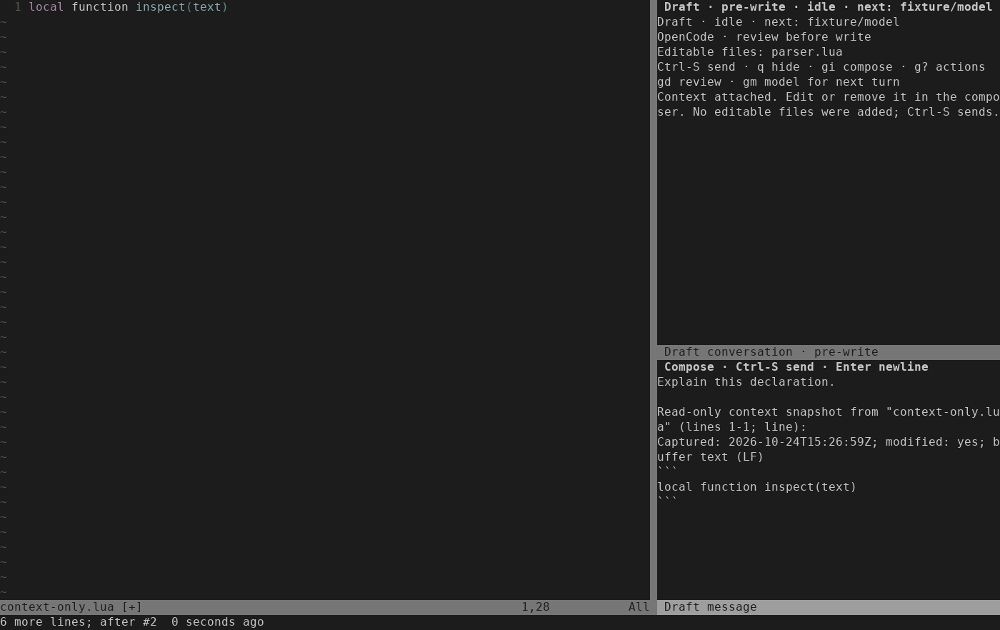
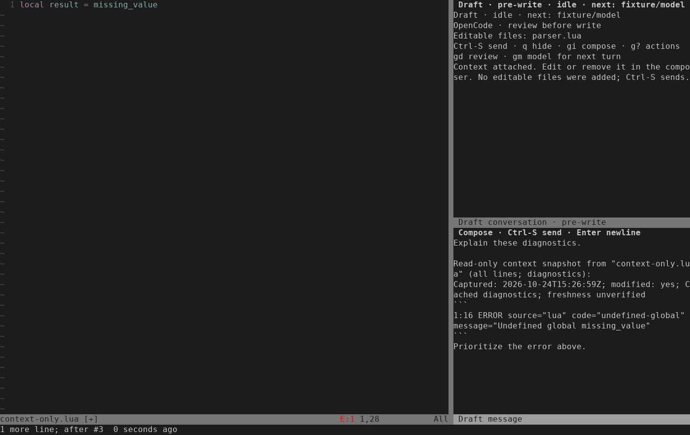

# Read-only context validation

Validated on 2026-10-24 on Linux with Neovim 0.12.4, LuaJIT 2.1.1774638290,
Python 3.14.4 and tmux 3.7c. The filename follows the implementation plan date.
The implementation uses the existing managed Codex and OpenCode controllers,
sandbox and review publisher. No live provider or real account was used.

## Observed behavior

- Text capture accepts whole buffers, exact Visual selections and command line
  ranges. Named in-root buffers can be unselected, modified or not yet saved.
  Capture leaves source text, modified state and editable selection unchanged.
- Captures label their path, range, time and modified state. Editor line
  boundaries use LF. Whole-buffer captures label the final-newline flag.
  Symlink aliases, outside-root paths and unsupported text are refused.
- Source spans above 1 MiB refuse before reading lines. Expanded selections
  above 32,768 bytes refuse before extraction, including virtual padding.
  Fitting partial tabs, wide/combining characters and exclusive selections retain
  their exact text. Fences, metadata, separators and existing draft text share
  the complete 32,768-byte message limit.
- Cached diagnostics count all namespaces for the current buffer. More than
  1,000 cached records refuse before retrieval, even with one matching line.
  An eligible cache is retrieved once. More than 100 matching records refuse
  without truncation. Zero records need no retrieval.
- Diagnostic blocks preserve duplicates and historical positions. They sort
  allowed fields deterministically, filter by starting line, omit nested
  payloads and always label freshness unverified. Capture requests no refresh.
- Public Attach and Diagnostics start no controller or authentication work.
  The shared append checks source, owner, revision and draft state after focus.
  Focus-time edits, rename, option changes, Close and owner replacement preserve
  newer state and refuse the stale capture.
- Both production backends receive the visible draft as message text. Their
  private workspace contains only the original editable files. A fake peer's
  attempt to write a context-only path never changes the real unselected file
  or admits it to review/publication. Enforcement does not depend on prompt wording.
- Dirty editable sources still refuse Send. Context can be prepared while
  a turn is starting and submitted as an explicit pending-review follow-up.
  The next ordinary message does not automatically append previous snapshots.
- After a safe pre-submission failure, empty-draft Retry sends the original
  captured text and diagnostics once, despite later source/cache changes.
  Hide preserves drafts; Close retains read-only history and the unsent draft.
  New confirms discarding that draft and starts empty. Unsafe Retry stays refused.

## Checks

The implementation was exercised with targeted RED-to-GREEN checks before each
production change. Final task checks:

| Command | Result |
| --- | --- |
| `python3 -I -B tests/run.py ai_chat_context ai_context` | 2/2 suites passed |
| `python3 -I -B tests/run.py ai_chat_context ai_chat_selection ai_chat_view draft_setup ai_chat ai_runtime ai_chat_controller` | 7/7 suites passed |
| `python3 -I -B tests/run.py ai_chat_context ai_chat_diagnostics ai_chat_selection draft_setup` | 4/4 suites passed |
| `python3 -I -B tests/run.py ai_chat_readonly_context ai_chat_recovery nvim_ai_conversation_controller nvim_ai_codex_turn nvim_ai_conversation_protocol nvim_ai_chat_ui` | 6/6 suites passed; controller 41 tests, Codex turn 15, protocol 16, terminal UI 13 |
| `stylua --check lua tests` | Passed |
| `git diff --check` | Passed |

The isolated runner removes ambient credentials and uses disposable HOME/XDG
directories and tmux sockets. Sandbox ownership and namespace checks remain
enabled. Task 4 logs: `.test-results/run-tr60bft4/`.

## Terminal evidence

Both PNGs come from real tmux ANSI captures. The composer was resized with
Neovim's normal `:resize` command so the complete snapshot is visible.
Tests also check the Editable files header at 70 columns. Real keys exercise
attachment, normal editing, undo/redo, Hide/reopen and one explicit Send.
The diagnostic test retains Neovim's normal diagnostic display callbacks.





Reproduce the captures from the checkout:

```sh
DRAFT_CHAT_CAPTURE_DIR=/tmp/draft-readonly-context-captures \
  python3 -I -B tests/nvim_ai_chat_ui.py \
  ChatUITest.test_visual_context_preserves_draft_until_explicit_send \
  ChatUITest.test_cached_diagnostics_preview_is_editable_and_explicit -q
python3 -I -B tests/fixtures/ai/render_chat_capture.py \
  /tmp/draft-readonly-context-captures/chat-readonly-context.ansi \
  docs/images/chat-readonly-context.png --columns 140
python3 -I -B tests/fixtures/ai/render_chat_capture.py \
  /tmp/draft-readonly-context-captures/chat-readonly-diagnostics.ansi \
  docs/images/chat-readonly-diagnostics.png --columns 140
```

The terminal test class isolates its own environment. The default runner
intentionally does not forward the optional capture variable.

## Limits and test ruling

Neovim's public diagnostic API does not provide a hard total memory or latency
bound. Counting traverses the cache. Retrieval copies nested producer payloads,
even though Draft omits them from the prompt. The record and message caps do
not remove that cost.

Three headless integration suites disable only the built-in
`nvim.diagnostic.status` autocmd. With Neovim 0.12.4, repeated isolated runs
crashed in native `grid_alloc`/`update_screen` when that callback redrew after
headless split changes. GDB located the crash; diagnostic cache operations
remain real. Statusline presentation is therefore covered by the terminal test,
not these headless suites. No production workaround or sandbox relaxation was added.

No native-mode behavior, installed-runtime audit, real account login or paid
provider call was exercised for this change. Existing installed-runtime evidence
does not validate the new composer feature. Already sent context can remain in
conversation/provider history; removing a draft is not provider-side erasure.
